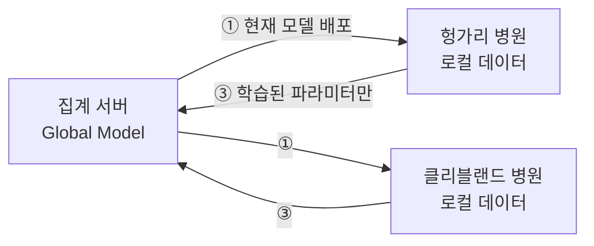
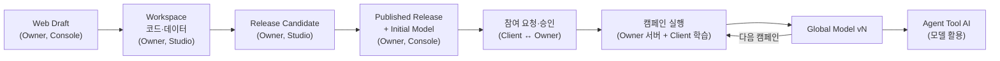

# 1. 연합학습과 FedOps 한눈에 보기
{: .no_toc }

{: .note }
> 📍 **지금 어디:** 공통 기초 1/3 — **① 연합학습과 FedOps** → ② 데이터와 모델 → ③ 준비하기

{: .important }
> 🎯 **이 단계에서 하는 일:** 손을 움직이기 전에 큰 그림을 잡습니다. 연합학습이 왜 필요한지, 누가 무엇을 하는지, FedOps 의 각 화면이 그중 어느 부분을 맡는지 알면 이후 단계에서 "지금 왜 이 버튼을 누르는지"가 보입니다.

1. TOC
{:toc}

## 연합학습이 풀려는 문제

좋은 모델을 만들려면 데이터가 많고 다양해야 합니다. 그런데 의료·금융처럼 민감한 데이터는 **한곳에 모을 수 없습니다.** 법·규정·계약이 막고, 모을 수 있더라도 유출 위험을 감당하기 어렵습니다. 나라가 다르면 더 어렵습니다. 그래서 병원마다 자기 데이터로만 모델을 만들면, 데이터가 적고 그 병원 환자에게 치우쳐 성능이 떨어집니다.

**연합학습(Federated Learning)** 은 거꾸로 합니다. 데이터를 모으는 대신 **모델을 데이터 쪽으로 보냅니다.**

1. 서버가 현재 모델을 각 참여 기관(**client**)에 보냅니다.
2. 각 client 는 자기 PC 안에서 자기 데이터로 그 모델을 조금 더 학습합니다.
3. 학습된 **파라미터(모델 안의 숫자)** 만 서버로 돌려보냅니다. 데이터는 PC 를 떠나지 않습니다.
4. 서버가 파라미터들을 하나로 합쳐(**집계**) 새 Global Model 을 만듭니다.

이 한 바퀴가 **라운드(round)** 입니다. 라운드를 여러 번 반복하면 Global Model 은 모든 기관의 데이터를 본 것처럼 좋아집니다(이상적으로는).

📚 연합학습 배경 — 무엇이 어려운가

- **데이터가 기관마다 다르다 (non-IID).** 이 튜토리얼의 두 병원도 그렇습니다. 헝가리 병원 환자는 심장병 비율이 38%, 클리블랜드 병원은 46% 이고, 나이·검사 수치 분포도 다릅니다. 각 client 가 자기 쪽으로 치우친 방향으로 모델을 당기므로, 단순히 합치면 한쪽에 맞지 않는 모델이 나올 수 있습니다. 이 튜토리얼은 이 차이를 일부러 만든 것이 아니라 **실제 병원 데이터에 원래 있는 차이**로 경험합니다.
- **통신이 비싸다.** 라운드마다 모델 전체가 오갑니다. 라운드 수와 참여 client 수가 곧 비용입니다.
- **참여자가 늘 있지 않다.** client 의 PC 가 꺼지거나 네트워크가 끊길 수 있습니다. 서버는 정해진 수의 client 가 모일 때까지 기다립니다.
- **파라미터만 보내도 완벽한 프라이버시는 아니다.** 파라미터에서 학습 데이터를 일부 추정하는 공격이 연구되어 있습니다. 차등 프라이버시·보안 집계 같은 기법이 따로 있고, 이 튜토리얼은 다루지 않습니다.

## 두 역할: Task Owner 와 Client

|  | Task Owner | Client (참여자) |
| --- | --- | --- |
| 하는 일 | 무엇을 학습할지 정하고, 코드·첫 모델을 만들어 공개하고, 학습을 운영한다 | 공개된 Task 에 참여해 자기 데이터로 로컬 학습을 한다 |
| 정하는 것 | 데이터 형식, 모델 구조, 라운드 수, 참여 인원, 누구를 받을지 | 참여할지 말지, 어떤 데이터를 넣을지 |
| 가진 데이터 | 설계와 첫 모델용 데이터 (없을 수도 있음). 이 튜토리얼에서는 헝가리 병원 기록 | 자기 기관의 데이터. 이 튜토리얼에서는 클리블랜드 병원 기록 |
| 주로 쓰는 화면 | FedOps Console + Agent Studio | Agent Studio (+ Registry) |
| 받는 것 | Global Model 과 전체 지표 | 자기 참여 기록과 지표 |

**한 계정이 두 역할을 다 할 수 있습니다.** Owner 가 자기 Task 에 Client 로도 참여하면 화면에 `Owner · Participant` 배지가 붙습니다. 혼자 연습할 때 이렇게 합니다.

## FedOps 의 구성 요소

| 이름 | 어디에 있나 | 맡는 일 | 누가 |
| --- | --- | --- | --- |
| **FedOps Web** | 웹 (홈페이지) | 소개·문서. 오른쪽 위 **Open Console** 로 Console 에 들어간다 | 모두 |
| **FedOps Console** | 웹 | Task 만들기, Registry 게시, 참여자 승인, 집계 서버·캠페인 운영, 모니터링 | 주로 Owner |
| **Agent Studio** | **내 PC** (Docker) | 코드 편집, 로컬 학습, 참여 준비 점검, 연합학습 참여, Agent 빌드·API | 모두 |
| **Federated Task** | Console + Studio | 연합학습의 단위. 모델·전처리·학습 코드·Tool 정의를 담은 코드 묶음 | Owner 가 만듦 |
| **Registry** | Console / Studio | 공개된 Task 목록. Client 는 여기서 Task 를 찾아 참여를 요청한다 | 모두 |
| **집계 서버 (FL server)** | FedOps 클라우드 | 라운드를 진행하고 파라미터를 합친다 | Owner 가 켬 |
| **Global Model** | Console | 연합학습 결과로 나온 모델 버전 (v1, v2, …) | 모두 볼 수 있음 |

> **Studio 가 내 PC 에서 도는 이유:** 데이터가 내 PC 를 떠나지 않아야 하기 때문입니다. 학습은 Studio(내 PC)에서, 합치기만 서버에서 합니다.

## FedOps 의 Task 생애

이 튜토리얼 전체가 따라가는 줄거리입니다. 각 상태를 누가 바꾸는지 보세요.

## 다음 단계

[2. 실습 데이터와 AI 모델]({{ '/v1.3/tutorial/basics/data-and-model/' | relative_url }}) — 이 튜토리얼에서 학습할 병원별 데이터와 모델이 무엇이고 왜 골랐는지 봅니다.
