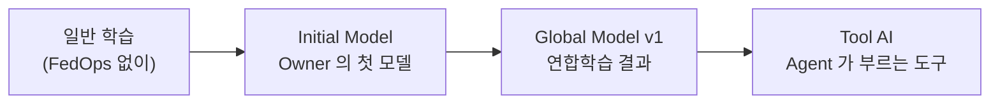

# 2. 실습 데이터와 AI 모델
{: .no_toc }

{: .note }
> 📍 **지금 어디:** 공통 기초 2/3 — ① 연합학습과 FedOps → **② 데이터와 모델** → ③ 준비하기

{: .important }
> 🎯 **이 단계에서 하는 일:** 이 튜토리얼에서 학습할 데이터와 모델을 이해합니다. Owner 는 이 모델을 설계·공개하고, Client 는 이 모델을 자기 병원 데이터로 학습시키며, 모델 활용 트랙에서는 이 모델이 Agent 의 도구가 됩니다. **세 트랙이 모두 같은 모델 하나를 다룹니다.**

1. TOC
{:toc}

## 데이터: UCI Heart Disease — 처음부터 병원별로 나뉜 데이터

1980년대에 **병원 4곳**이 각자 모은 심장 검사 기록입니다. 1988년 UCI ML Repository 에 병원별 파일로 공개됐고, 지금도 병원마다 파일이 따로 있습니다. 그래서 데이터를 일부러 나누지 않아도 "병원마다 자기 데이터만 가진" 연합학습 상황이 그대로 만들어집니다.

| 병원 | 나라 | 원본 행 | 정리 후 행 | 심장병 비율 | 이 튜토리얼 |
| --- | --- | --- | --- | --- | --- |
| Hungarian Institute of Cardiology (부다페스트) | 헝가리 | 294 | **261** | 38% | **Task Owner** |
| Cleveland Clinic Foundation | 미국 | 303 | **303** | 46% | **Client** |
| VA Medical Center (롱비치) | 미국 | 200 | 130 | 78% | 쓰지 않음 (참여자를 늘릴 때) |
| University Hospital Zurich · Basel | 스위스 | 123 | 46 | 98% | 쓸 수 없음 — 심장병 없는 환자가 1명뿐 |

"정리 후"는 결측이 많은 열 3개를 빼고, 남은 결측이 있는 행을 뺀 결과입니다(아래 전처리). 같은 데이터·같은 정리 방식이 의료 연합학습 벤치마크 **FLamby** 의 `Fed-Heart-Disease` 로 쓰입니다(NeurIPS 2022 Datasets & Benchmarks).

### 입력과 정답

환자 1명이 1행입니다. 입력 10개로 정답 1개를 맞힙니다.

| 열 | 뜻 | 값 |
| --- | --- | --- |
| `age` | 나이 | 세 |
| `sex` | 성별 | `1` 남 / `0` 여 |
| `cp` | 가슴 통증 유형 (**범주**) | `1` 전형적 협심증, `2` 비전형적 협심증, `3` 협심증 아닌 통증, `4` 증상 없음 |
| `trestbps` | 안정 시 혈압 | mmHg |
| `chol` | 혈청 콜레스테롤 | mg/dl |
| `fbs` | 공복 혈당 > 120 mg/dl | `1` 예 / `0` 아니오 |
| `restecg` | 안정 시 심전도 (**범주**) | `0` 정상, `1` ST-T 파 이상, `2` 좌심실 비대 |
| `thalach` | 운동 중 최대 심박수 | 회/분 |
| `exang` | 운동 유발 협심증 | `1` 예 / `0` 아니오 |
| `oldpeak` | 운동으로 생긴 ST 분절 하강 | mm |
| **`target`** (정답) | 심장병 | `0` = no_disease(없음), `1` = disease(있음) |

- 원본 정답 `num` 은 0~4 (0 = 없음, 1~4 = 혈관 좁아짐 정도)입니다. FLamby 와 같이 **`num > 0` 이면 심장병(1)** 으로 묶어 두 클래스로 만듭니다.
- 원본 파일의 입력은 13개지만 그중 `slope`·`ca`·`thal` 은 헝가리·스위스·VA 에서 대부분 비어 있어 뺐습니다(FLamby 와 같음).
- `cp`·`restecg` 는 숫자처럼 보이지만 **크기 순서가 없는 범주**입니다. "통증 유형 4 가 2 의 두 배"가 아닙니다. 템플릿은 이 두 열을 범주로 따로 다룹니다(`schema.py` 의 `CATEGORICAL_FEATURES`).
- 나머지 8개는 크기가 크게 다릅니다(`chol` 은 수백, `oldpeak` 는 0~6). 그래서 학습 전에 표준화(평균 0, 표준편차 1)를 합니다.

### 왜 이 데이터인가

| 이유 | 설명 |
| --- | --- |
| **처음부터 병원별로 나뉘어 있다** | 한 데이터를 튜토리얼이 임의로 쪼갠 것이 아니라, 실제로 다른 병원이 따로 모은 기록입니다. "병원마다 데이터가 다르다"는 연합학습의 핵심 어려움이 꾸며낸 것이 아닙니다 |
| **연합학습 연구에서 쓰는 데이터다** | FLamby 의 `Fed-Heart-Disease` 와 같은 분할이라, 이 튜토리얼에서 익힌 것을 논문의 실험과 바로 비교해 볼 수 있습니다 |
| **노트북 CPU 로 빠르다** | 병원마다 수백 행 × 10열이라 학습·점검·연합학습 라운드가 몇 초~몇 분이면 끝납니다 |
| **준비가 간단하다** | 원본 파일 4개(약 40 KB)가 실습 템플릿에 들어 있습니다. CC BY 4.0 이라 출처를 밝히면 재배포할 수 있습니다 |
| **Agent 와 잘 맞는다** | 입력이 나이·혈압·통증 유형처럼 사람이 읽을 수 있는 값이고, 출력이 "심장병 있음/없음 + 확률"이라 LLM 이 문장으로 설명하기 좋습니다 |

고르지 않은 후보: Breast Cancer Wisconsin(한 병원 데이터라 병원별로 나누려면 임의로 쪼개야 함 — 이 튜토리얼의 이전 판), FEMNIST(연합학습 논문의 표준이지만 이미지라 모델·Agent 입력이 크게 달라짐), FLamby 의 다른 의료 데이터(영상·3D 라 노트북 CPU 에 무거움).

{: .warning }
> **교육용입니다.** 여기서 만든 모델은 진단에 쓰지 않습니다. 이 데이터에서 정확도는 0.75~0.8 안팎이 보통이고, 이 튜토리얼의 목적은 정확도가 아니라 **FedOps 로 연합학습을 끝까지 돌려 보는 것**입니다.

### 두 병원은 어떻게 다른가 (non-IID)

|  | 헝가리 (Owner) | 클리블랜드 (Client) |
| --- | --- | --- |
| 행 | 261 | 303 |
| 심장병 없음 / 있음 | 163 (62%) / 98 (38%) | 164 (54%) / 139 (46%) |
| `prepare_data.py` 가 만드는 파일 | `data/out/hungarian/dataset.csv` | `data/out/cleveland/dataset.csv` |

이렇게 기관마다 데이터 분포가 다른 상태를 **non-IID** 라고 합니다. 현실의 연합학습은 거의 항상 non-IID 이고, 연합학습이 어려운 가장 큰 이유입니다. 실제 병원이라면 서로의 데이터를 볼 수 없지만, 여기서는 흐름을 이해하려고 두 병원의 비율을 모두 보여 줍니다.

## AI 모델이란

이 튜토리얼에서 **AI 모델은 "검사 값 10개를 받아 심장병일 확률을 내는 함수"** 입니다.

```txt
입력 (나이·혈압·통증 유형 등 10개)  →  [ 모델 ]  →  없음 0.32 / 있음 0.68
```

함수 안에는 **파라미터**라 부르는 숫자가 많이 들어 있습니다. 처음에는 아무렇게나 정해져 있어 엉뚱한 답을 내고, **학습**은 정답이 있는 데이터를 보여 주며 이 숫자들을 조금씩 고쳐 답을 맞히게 만드는 과정입니다.

**연합학습에서 오가는 것이 바로 이 파라미터입니다.** 각 병원은 데이터 대신 "우리 데이터로 고친 파라미터"를 보내고, 서버는 그 숫자들을 평균 냅니다. 그래서 모델이 무엇인지 알면 연합학습이 무엇을 주고받는지도 보입니다.

## 이 튜토리얼의 모델: 작은 MLP

템플릿의 모델(`TabularMLP`)은 층 3개짜리 **다층 퍼셉트론(MLP)**, 가장 기본적인 신경망입니다.

```txt
입력 10 → [선형 10→32 · 배치정규화 · ReLU · 드롭아웃 0.2]
        → [선형 32→16 · 배치정규화 · ReLU · 드롭아웃 0.2]
        → [선형 16→2]  → 두 클래스 점수(logits) → 확률
```

| 항목 | 값 |
| --- | --- |
| 학습되는 파라미터 수 | **1,010개** |
| 학습 설정 | Adam, learning rate 0.001, 30 epochs, batch 32 (`config.yaml`) |
| 프레임워크 | PyTorch |
| 출력 | `label`, `class_name`, `confidence`, `probabilities` |

범주 열(`cp`·`restecg`)은 모델에 들어가기 전에 "어휘표의 몇 번째 값인가"로 바뀐 뒤 다른 열과 같이 표준화됩니다. 어휘표에 없는 값(예: `cp` = 5)이 들어오면 학습·점검 단계에서 막힙니다.

### 왜 이 모델인가

| 이유 | 설명 |
| --- | --- |
| **작아서 빠르다** | 파라미터 1,010개라 노트북 CPU 로 몇 초면 학습되고, 라운드마다 오가는 양도 작습니다 |
| **표 형식 데이터에 맞다** | 이미지용 CNN·문장용 Transformer 는 이 데이터에 과합니다 |
| **내 모델로 바꾸기 쉽다** | PyTorch `nn.Module` 하나라, 템플릿의 이 클래스만 내 모델로 바꾸면 같은 흐름을 그대로 쓸 수 있습니다 |

### 이 모델이 튜토리얼에서 거치는 길

같은 모델 하나가 이름을 바꿔 가며 끝까지 갑니다.



| 이름 | 무엇인가 | 어디서 |
| --- | --- | --- |
| **일반 학습 모델** (`train_centralized.py`) | FedOps 없이 한 PC 에서 학습. "이 모델이 배우긴 하는가" 확인 | Owner 트랙 1장 |
| **Initial Model** (화면 표기 `Initiative Model`) | Owner 가 헝가리 데이터로 만든 첫 모델. 연합학습의 출발점 | Owner 트랙 4장 |
| **Global Model vN** | 두 병원의 학습을 합친 결과 | Owner 6~7장, Client 트랙 |
| **Tool AI** | Agent 가 숫자(예측)가 필요할 때 부르는 도구. LLM 은 그 숫자를 설명만 한다 | 모델 활용 트랙 |

<details markdown="1">
<summary>📚 연합학습 배경 — 모델 구조가 왜 고정되어야 하나</summary>

FedAvg 는 "client A 의 3번째 층 5번째 숫자"와 "client B 의 3번째 층 5번째 숫자"를 평균합니다. 구조가 하나라도 다르면 같은 자리가 없어 합칠 수 없습니다. 그래서 FedOps 는 Owner 가 정한 모델 구조를 **코드째로 배포**하고, 모든 client 가 그 코드로 모델을 만듭니다. Client 는 모델 구조를 바꿀 수 없고, 구조를 바꾸려면 Owner 가 새 Release 를 내야 합니다.

FedOps 는 이 약속을 **파라미터 서명(signature)** 으로 확인합니다. 파라미터의 이름·모양·자료형을 지문처럼 만들어, 서버와 client 의 모델이 정확히 같은 모양인지 참여 전에 검사합니다.

이 모델에는 배치정규화(BatchNorm) 층이 있습니다. 배치정규화는 데이터의 평균·분산 통계를 따로 들고 있는데, non-IID 상황에서는 이 통계가 병원마다 다릅니다. 이를 다루는 FedBN 같은 연구가 있습니다(이 튜토리얼에서는 다루지 않음).

</details>

## 출처

Janosi, A., Steinbrunn, W., Pfisterer, M., Detrano, R. (1989). *Heart Disease* [Dataset]. UCI Machine Learning Repository. [https://doi.org/10.24432/C52P4X](https://doi.org/10.24432/C52P4X) — CC BY 4.0. 병원별 데이터 책임자: 헝가리 Andras Janosi, 스위스 William Steinbrunn · Matthias Pfisterer, 클리블랜드·롱비치 Robert Detrano.

## 다음 단계

[3. 준비하기]({{ '/v1.3/tutorial/basics/setup/' | relative_url }}) — Docker 와 Agent Studio 를 설치하고 로그인합니다.
