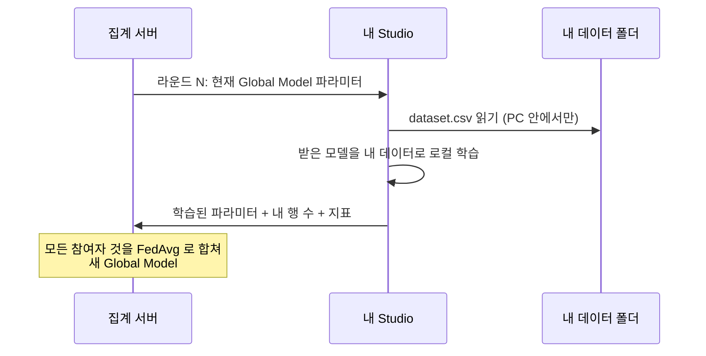

# 4. 연합학습 참여
{: .no_toc }

{: .note }
> 📍 **지금 어디:** Client 4/5 — ① 찾기·요청 → ② Workspace·데이터 → ③ 준비 점검 → **④ 참여** → ⑤ 마무리  화면: **Agent Studio** · 전제: Owner 가 [서버를 켰다]({{ '/v1.3/tutorial/owner/campaign/' | relative_url }}) (`● Server Live`)

{: .important }
> 🎯 **이 단계에서 하는 일:** 내 Studio 를 집계 서버에 붙여 라운드에 참여합니다. 라운드마다 서버가 보낸 Global Model 을 **내 PC 에서 내 데이터(클리블랜드)로** 학습하고, 학습된 파라미터만 서버로 보냅니다. 이 버튼 하나로 이 튜토리얼의 핵심인 "데이터를 옮기지 않는 학습"이 일어납니다.

1. TOC
{:toc}

## 🖱️ 따라 하기

카드에 **`● Server Live`** 가 보이는지 확인합니다. 보이지 않으면 Owner 가 아직 서버를 켜지 않은 것입니다. Task Data 줄에 **`✓ Local Ready`** 도 함께 있어야 Start Client 를 누를 수 있습니다. **서버가 새로 켜지면 준비 점검 결과가 `○ Check required` 로 풀립니다.** Start Client 전에 Task Data 줄의 **Check Participation Readiness** 를 다시 눌러 `✓ Local Ready` 를 확인합니다(약 5분 40초, 2026-10-20 Windows 노트북 실측).

1. 오른쪽 위 **Start Client** 를 누른다.

Start Client 직후에는 배지가 `connecting` · `Live` 로, Current Activity 가 `Global Model Sync` 로, 오른쪽 Model Flow 가 `Received Global Model vN → Local Model Update Pending → Waiting for aggregation` 으로 보입니다(받는 모델은 이번 캠페인의 출발 모델: 첫 캠페인이면 Initial Model, 다음부터는 직전 Global Model). 버튼은 **Stop Client** 로 바뀝니다.

먼저 붙은 쪽은 상대가 붙을 때까지 `waiting_round` (Current round `1 / 2`) 로 기다립니다. Console Monitoring 의 접속 수는 몇 분 늦게 갱신될 수 있습니다.

이 튜토리얼은 Owner 와 나 **둘 다 붙을 때까지** 라운드 1 이 시작되지 않습니다(Owner 가 정한 Clients per round = 2). Owner 도 자기 Studio 에서 Start Client 를 누릅니다. Start Client 부터 끝까지 약 2분 20초 걸렸습니다(2026-10-20 Windows 노트북 실측). 그 가운데 약 2분 10초는 내 PC 에서 Client 가 준비되는 시간이었고, 두 대가 모두 붙은 뒤 2라운드 학습·집계는 약 5초 만에 끝났습니다.

**`✓ Federated Learning completed`** 와 `Global Model v1` · `v1 · Round 2 / 2` 가 보이면 끝입니다(버전 번호는 Owner 가 돌린 캠페인 수에 따라 다릅니다). 끝난 직후에는 오른쪽 위에 **Finish Client Session** 버튼과 "The final aggregated Global Model was received. Finish the Client session when you are done reviewing this run." 안내가 보입니다. 서버는 끝나면 스스로 내려가고, 그러면 `✓ Client session ended` · `Server Offline` 으로 바뀝니다(5장).

## 지금 내 PC 에서 일어나는 일

## ⚙️ 해설 — 버튼과 화면

| 버튼·항목 | 하는 일 |
| --- | --- |
| **Start Client** | 서버에 붙어 라운드 참여를 시작한다 |
| **Stop Client** | **내 PC 의 참여만** 멈춘다. 다른 참여자나 캠페인 전체를 멈추지 않는다. 서버는 정해진 인원을 계속 기다린다 |
| Campaign | `v1 · Round 1 / 2` — 몇 번째 Global Model 을 만드는 판의 몇 라운드인지 |
| Clients per round | Owner 가 정한 라운드당 인원 |
| Participation History | 지난 참여 기록. 캠페인과 라운드를 골라 볼 수 있다 |

- 다른 화면으로 가도 Client 는 **뒤에서 계속 돕니다.**
- 같은 Task 의 Client 를 **두 번 시작하지 마세요.** 서로 다른 Task 의 Client 는 동시에 돌려도 됩니다.
- 학습 중에는 PC 를 잠자기 상태로 두지 마세요. 내가 빠지면 다른 참여자가 모두 기다립니다.

📚 연합학습 배경 — 내 기여는 얼마나 반영되나

FedAvg 는 각 참여자의 파라미터를 **학습에 쓴 행 수에 비례해** 평균합니다. 이 튜토리얼에서는 Owner(헝가리)가 261행, 나(클리블랜드)가 303행이라 Global Model 에는 대략 46 : 54 로 반영됩니다. 실제 가중치는 각자 `dataset.csv` 에서 학습용으로 떼어 낸 행 수로 계산됩니다(Client 는 Owner 의 행 수를 화면에서 볼 수 없습니다).

| 참여자 | `dataset.csv` 행 수 | 대략의 반영 비율 |
| --- | --- | --- |
| Owner (헝가리) | 261 | 46% |
| 나 (클리블랜드) | 303 | 54% |

내 병원의 환자 분포는 헝가리와 다르기 때문에, Owner 혼자서는 보지 못한 사례를 Global Model 에 보태게 됩니다. 다만 이 데이터에서는 두 병원을 합쳐도 성능이 오르는 폭이 작습니다([Owner 트랙 7장]({{ '/v1.3/tutorial/owner/results/' | relative_url }})).

## ✅ 체크리스트

- [ ] `● Server Live` 를 확인하고 Start Client 를 눌렀다
- [ ] `✓ Federated Learning completed` 와 `Round N / N` 을 봤다

## 안 되면

| 증상 | 조치 |
| --- | --- |
| `Server Live` 가 없음 | Owner 가 Start FL server 를 눌렀는지 확인 |
| Start 했는데 라운드가 시작되지 않음 | 다른 참여자가 아직 붙지 않았다. Owner 의 Clients per round 와 실제 참여 인원을 맞춘다 |
| `Participation Readiness is missing or outdated` | 3장 점검을 다시 한다 (데이터·코드가 바뀜, 또는 서버가 새로 켜짐) |
| Owner 는 서버를 켰다는데 내 화면은 계속 `Server Offline` | Studio 표시가 몇 분 늦게 바뀔 수 있다(이전 실습에서 약 4분). 연합학습 화면의 **Refresh** 를 누른다 |
| Start Client 를 누르자 `[Errno 2] No such file or directory: '…/task-binding.tmp'` | 점검 직후 Studio 가 파일을 쓰는 중에 눌린 것으로 보인다. **Refresh** 를 누르고 Start Client 를 다시 누른다 |

## 다음 단계

[5. 결과 확인과 마무리]({{ '/v1.3/tutorial/client/finish/' | relative_url }})
