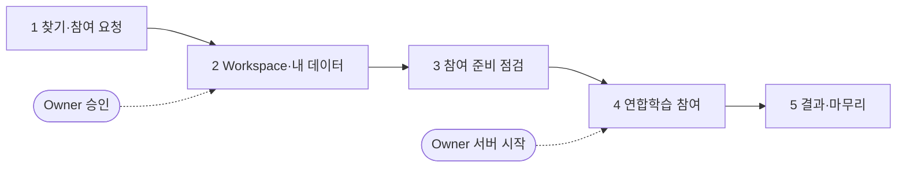

# Client 트랙
{: .no_toc }

남이 연 연합학습에 **내 데이터로 참여하는** 사람의 트랙입니다. 이 튜토리얼에서 나는 **클리블랜드 병원**이고, 헝가리 병원(Owner)과 함께 연합학습에 참여합니다(참여자는 Owner 와 나, 2명). 내 데이터는 내 PC 를 떠나지 않고, 학습된 파라미터만 서버로 갑니다.

{: .note }
> 먼저 [공통 기초]({{ '/v1.3/tutorial/basics/' | relative_url }})를 끝내세요. 참여하려면 Owner 가 [Owner 트랙 4장]({{ '/v1.3/tutorial/owner/release/' | relative_url }})까지 마쳐 Task 를 Registry 에 게시해 두어야 합니다.



| # | 페이지 | 어디서 | Owner 와 만나는 곳 |
| --- | --- | --- | --- |
| 1 | [Task 찾기와 참여 요청]({{ '/v1.3/tutorial/client/join/' | relative_url }}) | Registry (Console 또는 Studio) | **요청을 보낸다 → Owner 가 승인해야 다음으로** |
| 2 | [Workspace 와 내 데이터 준비]({{ '/v1.3/tutorial/client/workspace/' | relative_url }}) | Studio |  |
| 3 | [참여 준비 점검]({{ '/v1.3/tutorial/client/readiness/' | relative_url }}) | Studio |  |
| 4 | [연합학습 참여]({{ '/v1.3/tutorial/client/federated-learning/' | relative_url }}) | Studio | **Owner 가 서버를 켜야 시작할 수 있다** |
| 5 | [결과 확인과 마무리]({{ '/v1.3/tutorial/client/finish/' | relative_url }}) | Studio |  |

## Client 가 하지 않는 것

- 모델 구조나 학습 코드를 정하지 않습니다. **Owner 가 게시한 코드를 그대로** 실행합니다.
- 라운드 수·참여 인원을 정하지 않습니다(Owner 의 캠페인).
- 전처리 통계를 다시 계산하지 않습니다. Owner 가 코드에 고정해 둔 값을 씁니다.
- 데이터를 업로드하지 않습니다. 어디에도.

## 이 튜토리얼에서 쓰는 데이터

실제 상황이라면 Client 는 자기 기관 데이터를 갖고 있습니다. 실습에서는 템플릿에 들어 있는 클리블랜드 병원 원본으로 내 데이터를 만듭니다(2장).

```bash
cd FedOps-hands-on-guide/template/data
pip install numpy pandas
python prepare_data.py
ls out/cleveland/dataset.csv
```

| 파일 | 병원 | 행 | 심장병 없음 / 있음 | 누가 |
| --- | --- | --- | --- | --- |
| `hungarian/dataset.csv` | 헝가리 | 261 | 62% / 38% | Owner 가 씀 |
| `cleveland/dataset.csv` | 클리블랜드 | 303 | 54% / 46% | **Client (나)** |

`prepare_data.py` 는 두 병원 파일을 모두 만들지만, 나는 `cleveland` 만 씁니다. 원본을 정리만 하므로 Owner 가 만든 것과 같은 파일이 나옵니다.
