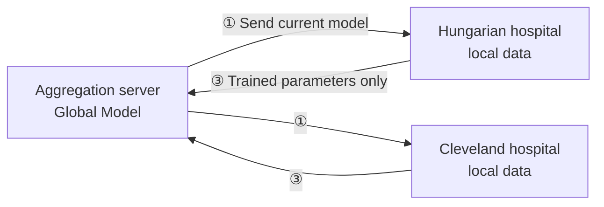
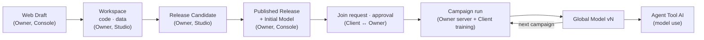

# 1. Federated Learning and FedOps at a Glance
{: .no_toc }

{: .note }
> 📍 **Where you are:** Basics 1/3 — **① Federated learning and FedOps** → ② Data and model → ③ Setup

{: .important }
> 🎯 **What you do in this step:** Get the big picture before touching anything. Once you know why federated learning is needed, who does what, and which part each FedOps screen handles, you will see "why I am clicking this button now" in the later steps.

1. TOC
{:toc}

## The problem federated learning solves

A good model needs a lot of varied data. But sensitive data, such as medical or financial records, **cannot be gathered in one place.** Laws, regulations, and contracts forbid it, and even when gathering is possible the leak risk is hard to accept. Across countries it is even harder. So if each hospital builds a model only from its own data, the data is small and skewed toward that hospital's patients, and performance suffers.

**Federated Learning** does the opposite. Instead of gathering the data, it **sends the model to the data.**

1. The server sends the current model to each participating institution (**client**).
2. Each client trains that model a bit further on its own data, inside its own PC.
3. Only the trained **parameters (the numbers inside the model)** go back to the server. The data never leaves the PC.
4. The server merges the parameters into one (**aggregation**) to make a new Global Model.

One such loop is a **round**. Repeating rounds makes the Global Model behave as if it had seen every institution's data (ideally).

📚 Federated learning background — what is hard

- **Data differs from institution to institution (non-IID).** The two hospitals in this tutorial are an example. 38% of the Hungarian hospital's patients have heart disease, versus 46% at Cleveland, and age and test value distributions differ too. Each client pulls the model toward its own data, so a simple merge can give a model that fits one side poorly. This tutorial does not create this difference on purpose; you experience it as **a difference that real hospital data already has**.
- **Communication is expensive.** The whole model travels every round. The number of rounds and of participating clients is the cost.
- **Participants are not always there.** A client's PC can be off or lose the network. The server waits until the required number of clients has gathered.
- **Sending only parameters is not perfect privacy.** Attacks that infer parts of the training data from parameters have been studied. Techniques such as differential privacy and secure aggregation exist separately; this tutorial does not cover them.

## Two roles: Task Owner and Client

|  | Task Owner | Client (participant) |
| --- | --- | --- |
| Does | Decides what to learn, builds and publishes the code and first model, runs the training | Joins a published Task and trains locally on its own data |
| Decides | Data format, model structure, number of rounds, number of participants, who to accept | Whether to join, what data to put in |
| Data held | Data for design and the first model (may have none). In this tutorial, the Hungarian hospital's records | Its own institution's data. In this tutorial, the Cleveland hospital's records |
| Main screens | FedOps Console + Agent Studio | Agent Studio (+ Registry) |
| Receives | The Global Model and overall metrics | Its own participation record and metrics |

**One account can play both roles.** When an Owner also joins its own Task as a Client, the screen shows an `Owner · Participant` badge. This is how you practice alone.

## FedOps components

| Name | Where | What it does | Who |
| --- | --- | --- | --- |
| **FedOps Web** | Web (home page) | Introduction and docs. **Open Console** at the top right takes you to the Console | Everyone |
| **FedOps Console** | Web | Create Tasks, publish to the Registry, approve participants, run the aggregation server and campaigns, monitoring | Mostly the Owner |
| **Agent Studio** | **My PC** (Docker) | Edit code, local training, readiness checks, join federated learning, build Agents and APIs | Everyone |
| **Federated Task** | Console + Studio | The unit of federated learning. A code bundle containing the model, preprocessing, training code, and Tool definition | Created by the Owner |
| **Registry** | Console / Studio | The list of published Tasks. Clients find Tasks here and request to join | Everyone |
| **Aggregation server (FL server)** | FedOps cloud | Runs the rounds and merges parameters | Started by the Owner |
| **Global Model** | Console | Model versions produced by federated learning (v1, v2, …) | Visible to everyone |

> **Why Studio runs on my PC:** the data must not leave my PC. Training happens in Studio (my PC); only the merging happens on the server.

## The life of a Task in FedOps

This is the storyline the whole tutorial follows. Note who changes each state.

## Next

[2. The Practice Data and the AI Model]({{ '/v1.3/tutorial/en/basics/data-and-model/' | relative_url }}) — what per-hospital data and model this tutorial trains, and why they were chosen.
