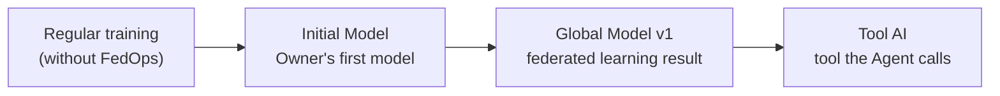

# 2. The Practice Data and the AI Model
{: .no_toc }

{: .note }
> 📍 **Where you are:** Basics 2/3 — ① Federated learning and FedOps → **② Data and model** → ③ Setup

{: .important }
> 🎯 **What you do in this step:** Understand the data and model you will train in this tutorial. The Owner designs and publishes this model, the Client trains it on its own hospital data, and in the Model Use Track this model becomes the Agent's tool. **All three tracks deal with one and the same model.**

1. TOC
{:toc}

## Data: UCI Heart Disease — split by hospital from the start

Heart test records that **four hospitals** each collected in the 1980s. They were published in the UCI ML Repository in 1988 as one file per hospital, and they still are. So without splitting anything on purpose, you get the federated learning situation where "each hospital holds only its own data".

| Hospital | Country | Original rows | Rows after cleaning | Heart disease rate | In this tutorial |
| --- | --- | --- | --- | --- | --- |
| Hungarian Institute of Cardiology (Budapest) | Hungary | 294 | **261** | 38% | **Task Owner** |
| Cleveland Clinic Foundation | USA | 303 | **303** | 46% | **Client** |
| VA Medical Center (Long Beach) | USA | 200 | 130 | 78% | Not used (for adding participants) |
| University Hospital Zurich · Basel | Switzerland | 123 | 46 | 98% | Unusable — only 1 patient without heart disease |

"After cleaning" means dropping three columns with many missing values and then dropping rows that still have missing values (see preprocessing below). The same data and the same cleaning are used as `Fed-Heart-Disease` in **FLamby**, a federated learning benchmark for healthcare (NeurIPS 2022 Datasets & Benchmarks).

### Inputs and target

One patient is one row. Ten inputs predict one target.

| Column | Meaning | Values |
| --- | --- | --- |
| `age` | Age | years |
| `sex` | Sex | `1` male / `0` female |
| `cp` | Chest pain type (**categorical**) | `1` typical angina, `2` atypical angina, `3` non-anginal pain, `4` asymptomatic |
| `trestbps` | Resting blood pressure | mmHg |
| `chol` | Serum cholesterol | mg/dl |
| `fbs` | Fasting blood sugar > 120 mg/dl | `1` yes / `0` no |
| `restecg` | Resting ECG (**categorical**) | `0` normal, `1` ST-T wave abnormality, `2` left ventricular hypertrophy |
| `thalach` | Maximum heart rate during exercise | bpm |
| `exang` | Exercise-induced angina | `1` yes / `0` no |
| `oldpeak` | ST depression induced by exercise | mm |
| **`target`** (target) | Heart disease | `0` = no_disease, `1` = disease |

- The original target `num` is 0–4 (0 = none, 1–4 = degree of vessel narrowing). As in FLamby, **`num > 0` means heart disease (1)**, giving two classes.
- The original files have 13 inputs, but `slope`, `ca`, and `thal` are mostly empty in Hungary, Switzerland, and VA, so they were dropped (same as FLamby).
- `cp` and `restecg` look like numbers but are **categories with no order**. "Pain type 4 is twice type 2" makes no sense. The template treats these two columns as categories separately (`CATEGORICAL_FEATURES` in `schema.py`).
- The other 8 columns differ a lot in scale (`chol` is in the hundreds, `oldpeak` is 0–6), so they are standardized (mean 0, standard deviation 1) before training.

### Why this data

| Reason | Explanation |
| --- | --- |
| **Split by hospital from the start** | Not one dataset split arbitrarily by the tutorial, but records actually collected separately by different hospitals. "Each hospital's data is different", the core difficulty of federated learning, is not made up |
| **Used in federated learning research** | Same split as FLamby's `Fed-Heart-Disease`, so you can compare what you learn here directly with published experiments |
| **Fast on a laptop CPU** | A few hundred rows × 10 columns per hospital, so training, checks, and federated rounds finish in seconds to minutes |
| **Simple to prepare** | The four original files (about 40 KB) are included in the practice template. CC BY 4.0, so they can be redistributed with attribution |
| **Fits an Agent well** | Inputs are human-readable values such as age, blood pressure, and chest pain type, and the output is "heart disease yes/no + probability", which an LLM can easily put into words |

Candidates not chosen: Breast Cancer Wisconsin (one hospital's data, so splitting by hospital means splitting arbitrarily — the previous edition of this tutorial), FEMNIST (the standard in federated learning papers, but images change the model and Agent input a lot), other FLamby medical data (imaging and 3D, heavy for a laptop CPU).

{: .warning }
> **This is for education.** Do not use the model built here for diagnosis. Accuracy on this data is typically around 0.75–0.8, and the purpose of this tutorial is not accuracy but **running federated learning end to end with FedOps**.

### How the two hospitals differ (non-IID)

|  | Hungary (Owner) | Cleveland (Client) |
| --- | --- | --- |
| Rows | 261 | 303 |
| No disease / disease | 163 (62%) / 98 (38%) | 164 (54%) / 139 (46%) |
| File made by `prepare_data.py` | `data/out/hungarian/dataset.csv` | `data/out/cleveland/dataset.csv` |

When data distributions differ across institutions like this, it is called **non-IID**. Real federated learning is almost always non-IID, and that is the biggest reason federated learning is hard. Real hospitals cannot see each other's data, but here both hospitals' rates are shown so you can understand the flow.

## What is an AI model

In this tutorial, **the AI model is "a function that takes 10 test values and outputs the probability of heart disease"**.

```txt
Input (10 values: age, blood pressure, chest pain type, ...)  →  [ model ]  →  no 0.32 / yes 0.68
```

Inside the function are many numbers called **parameters**. At first they are arbitrary and give wrong answers; **training** is the process of showing data with known answers and nudging these numbers until the model answers correctly.

**What travels in federated learning is exactly these parameters.** Each hospital sends "parameters adjusted on our data" instead of the data, and the server averages those numbers. So once you know what the model is, you also see what federated learning exchanges.

## The model in this tutorial: a small MLP

The template's model (`TabularMLP`) is a three-layer **multilayer perceptron (MLP)**, the most basic neural network.

```txt
Input 10 → [Linear 10→32 · BatchNorm · ReLU · Dropout 0.2]
         → [Linear 32→16 · BatchNorm · ReLU · Dropout 0.2]
         → [Linear 16→2]  → two class scores (logits) → probabilities
```

| Item | Value |
| --- | --- |
| Trainable parameters | **1,010** |
| Training settings | Adam, learning rate 0.001, 30 epochs, batch 32 (`config.yaml`) |
| Framework | PyTorch |
| Output | `label`, `class_name`, `confidence`, `probabilities` |

Categorical columns (`cp`, `restecg`) are turned into "which position in the vocabulary" before entering the model and then standardized together with the other columns. A value not in the vocabulary (e.g. `cp` = 5) is blocked at training or check time.

### Why this model

| Reason | Explanation |
| --- | --- |
| **Small and fast** | 1,010 parameters train in seconds on a laptop CPU, and little travels each round |
| **Fits tabular data** | CNNs for images or Transformers for text are overkill for this data |
| **Easy to swap for your model** | It is a single PyTorch `nn.Module`, so replacing this class in the template with your model lets you reuse the same flow |

### The path this model takes through the tutorial

One model goes all the way, changing its name along the way.



| Name | What it is | Where |
| --- | --- | --- |
| **Regular training model** (`train_centralized.py`) | Training on one PC without FedOps. Checks "does this model learn at all" | Owner Track ch. 1 |
| **Initial Model** (shown on screen as `Initiative Model`) | The first model the Owner builds on Hungarian data. The starting point of federated learning | Owner Track ch. 4 |
| **Global Model vN** | The result of merging both hospitals' training | Owner ch. 6–7, Client Track |
| **Tool AI** | The tool the Agent calls when it needs a number (prediction). The LLM only explains that number | Model Use Track |

<details markdown="1">
<summary>📚 Federated learning background — why the model structure must be fixed</summary>

FedAvg averages "client A's 5th number in layer 3" with "client B's 5th number in layer 3". If even one part of the structure differs, there is no matching position and nothing can be merged. So FedOps **distributes the Owner's model structure as code**, and every client builds the model from that code. Clients cannot change the model structure; changing it requires the Owner to publish a new Release.

FedOps checks this agreement with a **parameter signature**. It fingerprints the names, shapes, and dtypes of the parameters and checks, before joining, that the server's and client's models have exactly the same shape.

This model has BatchNorm layers. BatchNorm keeps separate mean and variance statistics of the data, and in non-IID settings those statistics differ by hospital. There is research on handling this, such as FedBN (not covered in this tutorial).

</details>

## Source

Janosi, A., Steinbrunn, W., Pfisterer, M., Detrano, R. (1989). *Heart Disease* [Dataset]. UCI Machine Learning Repository. [https://doi.org/10.24432/C52P4X](https://doi.org/10.24432/C52P4X) — CC BY 4.0. Data contributors by hospital: Hungary, Andras Janosi; Switzerland, William Steinbrunn · Matthias Pfisterer; Cleveland and Long Beach, Robert Detrano.

## Next

[3. Setup]({{ '/v1.3/tutorial/en/basics/setup/' | relative_url }}) — install Docker and Agent Studio and sign in.
