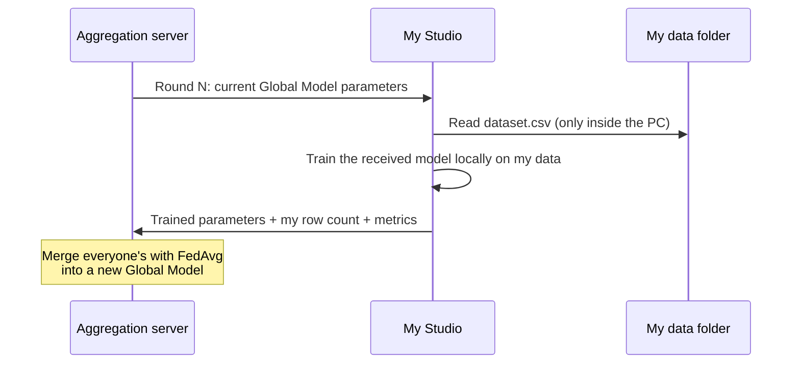

# 4. Join Federated Learning
{: .no_toc }

{: .note }
> 📍 **Where you are:** Client 4/5 — ① Find · request → ② Workspace · data → ③ Readiness check → **④ Join** → ⑤ Wrap-up  Screen: **Agent Studio** · Prerequisite: the Owner [started the server]({{ '/v1.3/tutorial/en/owner/campaign/' | relative_url }}) (`● Server Live`)

{: .important }
> 🎯 **What you do in this step:** Connect your Studio to the aggregation server and take part in rounds. Every round, you train the Global Model the server sent **on your PC with your data (Cleveland)** and send only the trained parameters back. This one button triggers the core of this tutorial: "training without moving data".

1. TOC
{:toc}

## 🖱️ Follow along

Check that the card shows **`● Server Live`**. If not, the Owner has not started the server yet. The Task Data row must also show **`✓ Local Ready`** for Start Client to be clickable. **When the server starts fresh, the readiness result resets to `○ Check required`.** Before Start Client, click **Check Participation Readiness** on the Task Data row again and confirm `✓ Local Ready` (about 5 min 40 s, measured on a Windows laptop on 2026-10-20).

1. Click **Start Client** at the top right.

Right after Start Client, the badges show `connecting` · `Live`, Current Activity shows `Global Model Sync`, and Model Flow on the right shows `Received Global Model vN → Local Model Update Pending → Waiting for aggregation` (the model received is this campaign's starting model: the Initial Model for the first campaign, the previous Global Model after that). The button changes to **Stop Client**.

Whoever connects first waits in `waiting_round` (Current round `1 / 2`) until the other connects. The connection count in Console Monitoring can lag several minutes.

In this tutorial, round 1 does not start until **both the Owner and you** connect (the Owner set Clients per round = 2). The Owner also clicks Start Client in their own Studio. From Start Client to the end took about 2 min 20 s (measured on a Windows laptop on 2026-10-20). About 2 min 10 s of that was the Client getting ready on your PC; once both machines were connected, two rounds of training and aggregation finished in about 5 seconds.

Done when you see **`✓ Federated Learning completed`** and `Global Model v1` · `v1 · Round 2 / 2` (the version number depends on how many campaigns the Owner ran). Right after finishing, the **Finish Client Session** button and the notice "The final aggregated Global Model was received. Finish the Client session when you are done reviewing this run." appear at the top right. The server shuts down by itself when done, and then the screen changes to `✓ Client session ended` · `Server Offline` (chapter 5).

## What is happening on your PC now

## ⚙️ Explained — buttons and screen

| Button · item | What it does |
| --- | --- |
| **Start Client** | Connects to the server and starts taking part in rounds |
| **Stop Client** | Stops **only your PC's participation**. It does not stop other participants or the whole campaign. The server keeps waiting for the set number of participants |
| Campaign | `v1 · Round 1 / 2` — which round of the run producing which Global Model |
| Clients per round | Participants per round set by the Owner |
| Participation History | Past participation records. Choose a campaign and round to view |

- The Client **keeps running in the background** even if you go to another screen.
- **Do not start the Client of the same Task twice.** Clients of different Tasks can run at the same time.
- Do not let your PC sleep during training. If you drop out, every other participant waits.

📚 Federated learning background — how much does my contribution count

FedAvg averages each participant's parameters **in proportion to the rows used for training**. In this tutorial the Owner (Hungary) has 261 rows and you (Cleveland) have 303, so the Global Model reflects you roughly 46 : 54. The actual weights are computed from the rows each side sets aside for training from `dataset.csv` (the Client cannot see the Owner's row count on screen).

| Participant | `dataset.csv` rows | Approximate share |
| --- | --- | --- |
| Owner (Hungary) | 261 | 46% |
| You (Cleveland) | 303 | 54% |

Your hospital's patient distribution differs from Hungary's, so you add cases the Owner could not see alone to the Global Model. On this data, however, combining the two hospitals raises performance only a little ([Owner Track ch. 7]({{ '/v1.3/tutorial/en/owner/results/' | relative_url }})).

## ✅ Checklist

- [ ] You checked `● Server Live` and clicked Start Client
- [ ] You saw `✓ Federated Learning completed` and `Round N / N`

## If something goes wrong

| Symptom | Fix |
| --- | --- |
| No `Server Live` | Check that the Owner clicked Start FL server |
| Started but rounds do not begin | Another participant has not connected yet. Match the Owner's Clients per round with the actual number of participants |
| `Participation Readiness is missing or outdated` | Redo the chapter 3 check (data or code changed, or the server was restarted) |
| The Owner says the server is on, but my screen keeps showing `Server Offline` | Studio's display can lag several minutes (about 4 minutes in an earlier run). Click **Refresh** on the federated learning screen |
| Start Client fails with `[Errno 2] No such file or directory: '…/task-binding.tmp'` | Probably clicked while Studio was writing a file right after the check. Click **Refresh** and click Start Client again |

## Next

[5. Check Results and Wrap Up]({{ '/v1.3/tutorial/en/client/finish/' | relative_url }})
