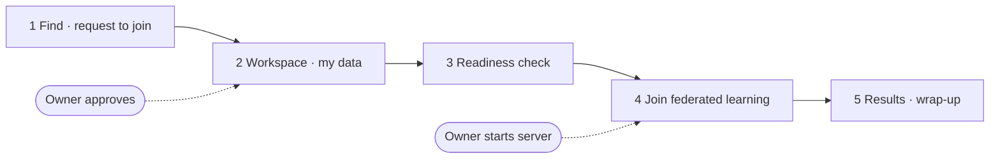

# Client Track
{: .no_toc }

The track for the person who **joins someone else's federated learning with their own data**. In this tutorial you are the **Cleveland hospital**, joining federated learning together with the Hungarian hospital (the Owner) — two participants, the Owner and you. Your data never leaves your PC; only trained parameters go to the server.

{: .note }
> Finish [Basics]({{ '/v1.3/tutorial/en/basics/' | relative_url }}) first. To join, the Owner must have finished [Owner Track chapter 4]({{ '/v1.3/tutorial/en/owner/release/' | relative_url }}) and published the Task to the Registry.



| # | Page | Where | Where you meet the Owner |
| --- | --- | --- | --- |
| 1 | [Find the Task and Request to Join]({{ '/v1.3/tutorial/en/client/join/' | relative_url }}) | Registry (Console or Studio) | **You send a request → the Owner must approve before you continue** |
| 2 | [Workspace and My Data]({{ '/v1.3/tutorial/en/client/workspace/' | relative_url }}) | Studio |  |
| 3 | [Participation Readiness Check]({{ '/v1.3/tutorial/en/client/readiness/' | relative_url }}) | Studio |  |
| 4 | [Join Federated Learning]({{ '/v1.3/tutorial/en/client/federated-learning/' | relative_url }}) | Studio | **The Owner must start the server before you can start** |
| 5 | [Check Results and Wrap Up]({{ '/v1.3/tutorial/en/client/finish/' | relative_url }}) | Studio |  |

## What the Client does not do

- Does not decide the model structure or training code. Runs **the code the Owner published, as is**.
- Does not decide the number of rounds or participants (the Owner's campaign).
- Does not recompute preprocessing statistics. Uses the values the Owner fixed in the code.
- Does not upload data. Anywhere.

## The data used in this tutorial

In real life the Client already has its own institution's data. For practice, you build your data from the original Cleveland hospital file included in the template (chapter 2).

```bash
cd FedOps-hands-on-guide/template/data
pip install numpy pandas
python prepare_data.py
ls out/cleveland/dataset.csv
```

| File | Hospital | Rows | No disease / disease | Who |
| --- | --- | --- | --- | --- |
| `hungarian/dataset.csv` | Hungary | 261 | 62% / 38% | Used by the Owner |
| `cleveland/dataset.csv` | Cleveland | 303 | 54% / 46% | **Client (you)** |

`prepare_data.py` builds both hospital files, but you only use `cleveland`. It only cleans the original files, so you get exactly the same file the Owner would.
