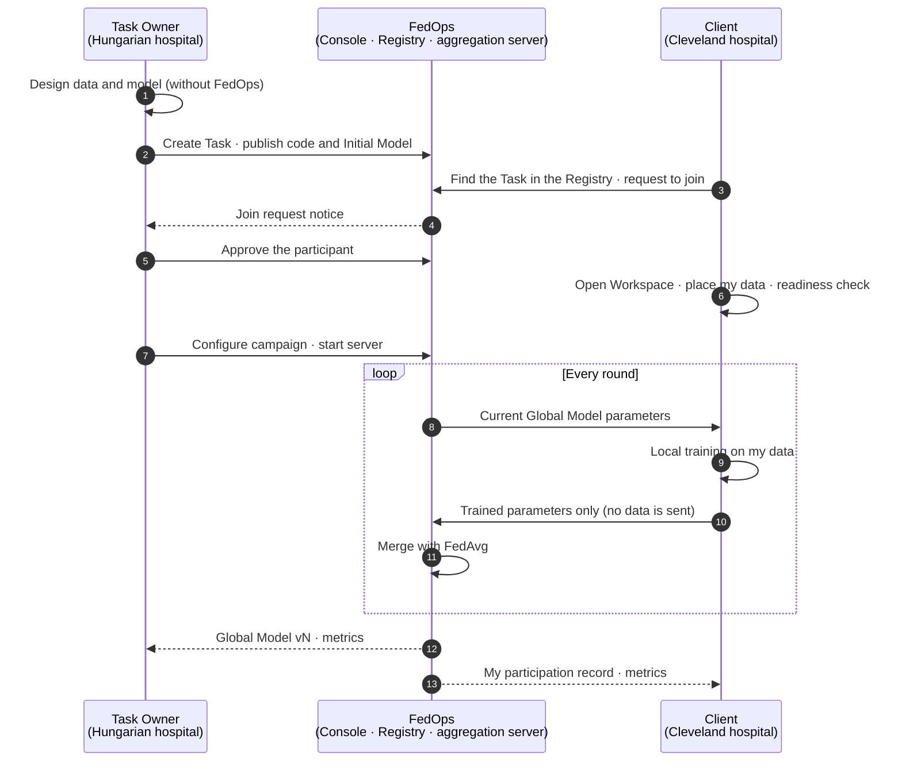

# FedOps Tutorial
{: .no_toc }

Learn both roles of federated learning — Task Owner and Client — hands-on with one public medical dataset, in FedOps 1.3
{: .fs-5 .fw-400 }

[한국어]({{ '/v1.3/tutorial/' | relative_url }})

{: .note }
> This tutorial does not just list buttons to click. At every step it explains **what you are doing, why, and what changes if you pick a different option**, together with the federated learning background behind it. The goal is that, once you finish, you can apply the same flow to your own data and your own model.

## What you will do

**Two hospitals in different countries** train a **heart disease classifier (no disease / disease)** together without pooling their patient records. The data is UCI Heart Disease, which was actually collected and published hospital by hospital — the **Task Owner** holds the records of a hospital in Hungary, and the **Client** holds the records of the Cleveland hospital in the US. The Owner designs and runs the training; the Client joins with its own data. When training is done, you attach the model to an LLM Agent as a tool and call it over an API.

## Pick your role first

| I want to… | Reading order |
| --- | --- |
| **Open and run federated learning** (Task Owner) | [Basics]({{ '/v1.3/tutorial/en/basics/' | relative_url }}) → [Task Owner Track]({{ '/v1.3/tutorial/en/owner/' | relative_url }}) → (optional) [Model Use Track]({{ '/v1.3/tutorial/en/model-use/' | relative_url }}) |
| **Join someone else's federated learning with my data** (Client) | [Basics]({{ '/v1.3/tutorial/en/basics/' | relative_url }}) → [Client Track]({{ '/v1.3/tutorial/en/client/' | relative_url }}) |
| **Try both roles on my own** | Basics → Owner Track 1–5 → Client Track → Owner Track 6–7. One account can be both Owner and Client |
| **Plug the finished model into my service** | [Basics]({{ '/v1.3/tutorial/en/basics/' | relative_url }}) → [Model Use Track]({{ '/v1.3/tutorial/en/model-use/' | relative_url }}) |

## The whole flow — where the two roles meet

**The two roles meet in only three places:** ③ join request ↔ ⑤ approval, ⑦ server start ↔ joining rounds, and the results. Everything else each side does on its own screen. The **📍 Where you are** box at the top of every page tells you where you are in this picture.

## How to read the pages

Every step page follows the same frame.

| Box | Content |
| --- | --- |
| 📍 **Where you are** | Your current position in the whole flow and the next step |
| 🎯 **What you do in this step** | What you do and why |
| 🖱️ **Follow along** | Real screenshots. **Red boxes + numbers** are where to click, and match the numbers in the text |
| ⚙️ **Options explained** | What each option on the screen decides, what changes if you change it, and why this tutorial picks that value |
| 📚 **Federated learning background** | The federated learning concept behind the choice (collapsed box) |
| ✅ **Checklist** | Fill it in, then move on |

## What you need and how long it takes

| Item | Requirement |
| --- | --- |
| PC | macOS / Windows / Linux, 16 GB memory recommended, 20 GB+ free disk |
| Docker | Latest Docker Desktop (or Docker Engine + compose) |
| Python | 3.10 or later, below 3.13 (3.12 recommended) |
| Accounts | FedOps accounts. This tutorial assumes **one Owner + one Client, two accounts** (two PCs recommended) |
| Data | The practice template contains the original UCI Heart Disease files. `prepare_data.py` builds per-hospital CSVs; the Owner uses `hungarian` (Hungary) and the Client uses `cleveland` (Cleveland) |

| Track | Time |
| --- | --- |
| Basics (including install and LLM download) | 1–2 hours |
| Task Owner | 2–3 hours |
| Client | 1 hour |
| Model Use | 1–2 hours |

## Good to know

- **This is public data for education.** Do not use the model built here for diagnosis.
- **The goal of this tutorial is not high accuracy but running federated learning end to end with FedOps.** Accuracy on this data is around 0.75–0.8, and the numbers on screen are measured **examples**.
- **Each participant uses a different hospital's data.** During federated learning nobody sends or sees anyone else's data.
- Screens are as of FedOps 1.3 and Agent Studio, October 2026. Button names may change in later versions.
- Most screens are in English. Some messages from the practice template and the demo app are in Korean; this guide shows them as they appear, with an English translation in parentheses.
- Practice template: [https://github.com/gachon-CCLab/FedOps-hands-on-guide](https://github.com/gachon-CCLab/FedOps-hands-on-guide)
- Data source: Janosi, Steinbrunn, Pfisterer, Detrano (1989), *Heart Disease*, UCI Machine Learning Repository, [https://doi.org/10.24432/C52P4X](https://doi.org/10.24432/C52P4X) (CC BY 4.0)
