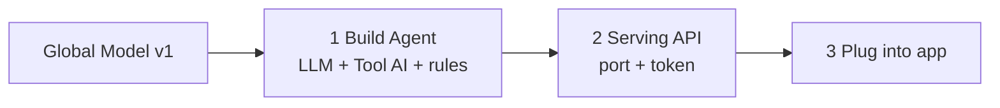

# Model Use Track
{: .no_toc }

The track for **actually using** the Global Model built by federated learning. You attach the model to an LLM Agent as a tool (Tool AI), open it as an HTTP API, and call it from your app.

{: .note }
> Prerequisite: you have finished [Owner Track chapter 7]({{ '/v1.3/tutorial/en/owner/results/' | relative_url }}) and have Global Model v1. (You can also skip federated learning and use the Initial Model from Owner Track chapter 4.) This track assumes the **Owner account**. Whether a Client account can do the same has not been verified yet.



```txt
Base LLM (language)  +  Tool AI (my model)  +  Harness (rules)  =  Agent
```

**Numbers come from the model, sentences from the LLM.** In the Agent's answer, the prediction (no disease / disease probabilities) comes from the Tool AI built by federated learning, and the LLM only explains those numbers in plain words. This principle runs through the whole track.

| # | Page | Where |
| --- | --- | --- |
| 1 | [Build an AI Agent]({{ '/v1.3/tutorial/en/model-use/agent/' | relative_url }}) | Studio Agent Builder |
| 2 | [Call It over an API]({{ '/v1.3/tutorial/en/model-use/serving-api/' | relative_url }}) | Studio Agents + terminal |
| 3 | [Demo App · Plug into Your Project]({{ '/v1.3/tutorial/en/model-use/app/' | relative_url }}) | Browser + your code |
