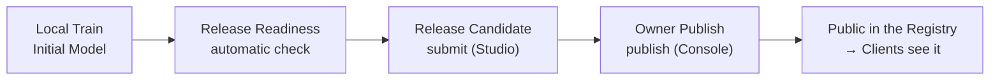

# 4. Train the First Model and Publish to the Registry
{: .no_toc }

{: .note }
> 📍 **Where you are:** Task Owner 4/7 — ① Design → ② Create Task → ③ Workspace → **④ Train · publish** → ⑤ Approve → ⑥ Campaign → ⑦ Results  Screen: **Agent Studio** → **FedOps Console** · Next: wait for the Client's join request

{: .important }
> 🎯 **What you do in this step:** Build the **first model (Initial Model)** on the Owner's Hungarian data, get an automatic check that the code keeps its agreement with FedOps, then bundle code + first model + README and **publish it to the Registry**. From the moment you publish, **Clients can find this Task and request to join.** This is where the Owner track first connects with the Client.

1. TOC
{:toc}

## 1) Local Train & Export Model

Do this in Agent Studio → Workspace → `handson-heart` → **Task Test** tab (the screen where you saw `Data detected` at the end of chapter 3).

1. Click **Local Train & Export Model**.

Scroll down and `running · Local Train` appears in the history on the left, with progress logs in the black panel on the right. Wait **about 2 minutes** (measured 2026-10-20 on a Mac).

Done when STATUS changes to `succeeded` and the metric cards appear. Look at the boxed cards (measured 2026-10-20, test set of 53 of the 261 Hungarian rows).

| Card | Value |
| --- | --- |
| PRIMARY METRIC (accuracy) | **0.7736** |
| F1 MACRO | 75.39% |
| F1 NO DISEASE / F1 DISEASE | 82.35% / **68.42%** |

- **It passes if clearly above 0.62 (always guessing "no disease").** 62% of the Hungarian data has no heart disease.
- It may be lower than chapter 1's regular training (about 0.8 with both hospitals pooled). Here only the Hungarian data was used.
- **Look at F1 DISEASE.** It is how well heart disease patients are caught. The Hungarian data has only 98 heart disease patients, so this value (68.42%) came out below accuracy. It missed 7 of the 20 heart disease patients in the test set as "no disease" (CONFUSION 1 0 = 7). In federated learning (chapter 6) you will see how this value changes.

> **Why this model matters:** the model built here is the **Initial Model**. When federated learning starts in chapter 6, the server sends this model to every Client as the starting point of round 1. Starting from a model that has already learned something takes fewer rounds than starting from scratch.

## 2) Check Release Readiness

FedOps checks one by one whether the Task keeps its agreement.

1. Scroll up and click **Check Release Readiness**. (2–3 minutes, measured 2 min 24 s on 2026-10-20)

### ⚙️ Explained — what Readiness prevents

| Check | What happens if it fails |
| --- | --- |
| Required files and README sections | Clients cannot know the data format, purpose, or limits |
| Model file size and checksum | Clients receive a model broken in transit |
| Short training gives a finite loss and changes parameters | Clients run rounds of training that learns nothing |
| A federated client can be built with my model | Connection errors only after the server starts |
| Tool AI prediction runs | In the Model Use Track, the Agent cannot call the model |
| No raw data or paths leak | The Owner's data or PC paths get mixed into the published bundle |

When federated learning breaks, it breaks on several institutions' PCs at once. So there is a step where you **run everything once on the Owner's PC before publishing**.

## 3) Submit Release Candidate

It passes when **"✓ Release Readiness passed. This Workspace can be submitted."** appears below the button.

{: .note }
> A low number such as ACCURACY **25.00%** below can be ignored. It is from a very short training run for checking. The model's performance is the 0.7736 from 1).

1. Click **Submit Release Candidate**.

After a few seconds, **"Release Candidate submitted: revision 1 · ready · release-…"** appears. That is all for Studio.

## 4) Publish to the Registry (FedOps Console)

Now go to the **FedOps Console** (`https://ccl.gachon.ac.kr/fedops/console`) in your browser.

1. In My Federated Tasks, click the **handson-heart** card.

1. Click the **Registry Release** tab.

1. Click **Refresh Releases**. Only needed if Revision 1 is not visible.
2. Click **Make Public & Owner Publish** for Revision 1. It publishes immediately, with no confirmation dialog.

{: .warning }
> **Publishing makes the Task Public**, even if you created it as Private. Code, model, and README become public; data is not uploaded. If you do not want it public after the practice, you can delete it with Task actions → **Delete task** in the Console.

The badge changes `Private` → **`Public`**, Revision 1 becomes **`published`**, and the button on the right changes to `Withdraw` (unpublish).

1. Click **View in Registry** to see the public view in a new tab.

## 5) Check in the Registry

The **Heart Disease MLP** card appears in the **Registry** list in the top menu. The card title is not the Task name but the model display name in `config.yaml` (`display_name`). Other people can find the Task through this card and request to join.

Clicking the card shows the template's `README.md` as is on the **Federated Task Card**: the meaning of the 10 columns, the data source, and uses to avoid (diagnosis). The README is the public documentation.

### ⚙️ Options explained — publishing buttons

| Button | What it does | This tutorial |
| --- | --- | --- |
| **Make Public & Owner Publish** | Finalizes the Release Candidate as the Published Release and makes the Task Public | Clicked — it must be public for Clients to find it |
| **Withdraw** | Unpublishes | Not clicked (not verified in practice) |
| Task actions → **Delete task** | Deletes the Task. Cannot be undone | When the practice is over and you do not want it public |

**A Release is a fixed bundle.** Editing the Workspace code after publishing does not change the code that goes to Clients. To change the code, go through Readiness → Release Candidate (revision 2) → publish again.

📚 Federated learning background — why fix the Release

Within a round, every Client must train with **exactly the same code and model structure**. If some Clients train with old code and others with new code, parameter shapes may differ so they cannot be merged, or they merge but mean different things. So FedOps treats a published Release as an immutable snapshot, and when the server starts it fixes "which Release, starting from which model" together (chapter 6).

## ✅ Checklist

- [ ] Local Train is `succeeded` and PRIMARY METRIC is above 0.62
- [ ] `Release Readiness passed` appeared
- [ ] `Release Candidate submitted: revision 1` appeared
- [ ] In the Console the Task is `Public` and Revision 1 is `published`
- [ ] The Heart Disease MLP card and README are visible in the Registry

## If something goes wrong

| Symptom | Fix |
| --- | --- |
| PRIMARY METRIC near 0.62 | Raise `epochs` in `config.yaml` (default 30) |
| Local Train fails immediately with a data error | Go back to chapter 3 step 4) and check for `Data detected` |
| Value-not-in-vocabulary error (`cp`, `restecg`) | You edited `dataset.csv` by hand or put in other data. Rebuild it with `prepare_data.py` |
| `README is missing sections` | The README must have Intended use / Local data setup / Federated participation / Limitations / Privacy sections |
| `model.display_name must be finalized` | `display_name` in `config.yaml` is still the default. Check that you put in the template's `config.yaml` |
| Class shortage error | Each class needs at least 3 rows |
| Submit Release Candidate is disabled | Release Readiness must pass first. If you changed code, check again |
| No candidate in Registry Release | Click **Refresh Releases** |
| Published by mistake | The Registry Release tab has an unpublish button, **Withdraw** (not tried in practice). To take the Task down completely, Task actions → **Delete task** |

## Next

[5. Approve Participants]({{ '/v1.3/tutorial/en/owner/participants/' | relative_url }}) — now Clients can find this Task and request to join. What happens on the Client side is in [Client Track ch. 1]({{ '/v1.3/tutorial/en/client/join/' | relative_url }}).
