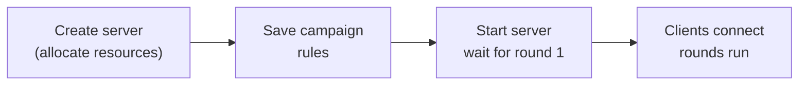

# 6. Configure the Campaign and Start the Server
{: .no_toc }

{: .note }
> 📍 **Where you are:** Task Owner 6/7 — ① Design → ② Create Task → ③ Workspace → ④ Train · publish → ⑤ Approve → **⑥ Campaign** → ⑦ Results<br> Screen: **FedOps Console** · Other side: when you start the server, the Client starts joining in [Client Track ch. 4]({{ '/v1.3/tutorial/en/client/federated-learning/' | relative_url }}) · Next: watch training and read the results

{: .important }
> 🎯 **What you do in this step:** Set the rules of this one run of federated learning (**campaign**) — how many rounds, how many participants per round, and how to merge — and start the **aggregation server** that collects and merges parameters. This step has the most options in the tutorial and the most direct effect on the results.

1. TOC
{:toc}



## 1) Create the aggregation server

Go to FedOps Console → My Federated Tasks → `handson-heart`.


1. Click the **Server Management** tab.


1. Scroll down and click **Create scalable server** under Server lifecycle. It starts creating immediately, with no confirmation dialog.


Wait until the **FL server** field in Runtime overview at the top goes from `FL Server Creating` → **`FL Server created`**. Measured 1 min 30 s on 2026-10-20.

1. If it does not change, click **Refresh status**.

> **"Create" and "start" are different.** Here you only reserve the place (compute resources) in the cloud for the server to run; federated learning has not started yet.

## 2) Set the campaign rules


1. Set **Rounds**.
2. Set **Clients per round**. The default is `1`; change it to `2`. (See the table below.)
3. Click **Check evaluation setup**. Click it after the server is `FL Server created`; before that you get `Validation check unavailable`.
4. Click **Save campaign**.

| Situation | Rounds | Clients per round |
| --- | --- | --- |
| **Practicing alone** (the Owner is also the Client) | 2 | **1** |
| **This tutorial** (Owner + 1 Client) | **2** | **2** — rounds proceed only when both hospitals join |
| Accepting more hospitals (e.g. 3 with the VA hospital) | 2 or more | Actual number of participants |


Done when you see green **Evaluation setup ready** and **Saved**.

### ⚙️ Options explained — campaign

| Option | What it decides | If you increase or change it | This tutorial |
| --- | --- | --- | --- |
| **Rounds** | How many times the server loops "send → local training → merge" (1 or more) | More can refine the Global Model, but time and communication grow, and at some point it hardly improves | **2** — short, since the goal is to see the flow. Also the FedOps template's recommended value |
| **Clients per round** | **How many must finish training** in a round before the server merges (1 or more) | More reflects more data per round, but the server waits until that many gather. **If larger than the real number of participants, rounds never start** | **2** — the number who will actually take part (Owner + Client) |
| **Aggregation strategy** | How parameters are merged | In FedOps 1.3 **only FedAvg** can be chosen. The list comes from the methods the published Release declares | **FedAvg** |
| **Global model evaluation** | Where the Global Model is scored | Explained separately below | **Validation OFF · Client metrics** |

#### Global model evaluation

| Choice | Where scoring happens | Needs | Trade-offs |
| --- | --- | --- | --- |
| **Validation OFF · Client metrics** | Each Client evaluates on its own test data, and the server takes a **weighted average proportional to data size** | Nothing | The Owner does not need separate validation data. But if hospitals' data differ, so do the yardsticks |
| **Validation ON · Server evaluation** | The server evaluates the Global Model directly on **common validation data** uploaded by the Owner | Server validation dataset uploaded from Studio, passing Check evaluation setup | Every round is compared with the same yardstick. But the Owner must hold representative validation data, and that data goes to the server |

This tutorial uses **OFF**: it is the basic form where federated learning runs without the Owner uploading data to the server. The template's `config.yaml` also has `server_evaluation.enabled: false`. ON is not covered in this tutorial.

<details markdown="1">
<summary>📚 Federated learning background — FedAvg and rounds</summary>

**FedAvg (Federated Averaging)**, proposed by Google in 2017, is the most basic aggregation method. It averages the parameters each client sends with **weights proportional to the amount of data**.

```txt
Global = (n₁ × Hungary's parameters + n₂ × Cleveland's parameters) / (n₁ + n₂)
         n = rows each trained on this round (the Client sends it to the server with the parameters)
```

Hospitals with more data have a bigger say. In this tutorial Cleveland (303 rows) counts slightly more than Hungary (261 rows). Under non-IID, the Global Model leans toward the distribution of the hospital with more data.

**Balancing rounds and local training.** Within each round a client trains several times on local data. More local training means fewer rounds (less communication) are needed, but under non-IID each client drifts far toward its own data (client drift), and merging can even make things worse. Methods such as FedProx were introduced to reduce this (not available in FedOps 1.3).

**Clients per round is also a rule for "waiting".** The server waits until the set number of participants finish training. If a Client leaves with Stop Client, this value does not shrink automatically; the server keeps waiting for other eligible Clients.

</details>

## 3) Start the server


1. Click **Start FL server** in the Command console.
2. Click **Show live log**.

![[ROUND 1] in the live log]({{ '/tutorial/images/ho6-08.png' | relative_url }})

When **`[ROUND 1]`** and **`server start by round`** appear at the bottom of the Live server log, the server is waiting for participants.

{: .highlight }
> Scrolling up in the live log shows many AWS-related DEBUG lines. One of them prints the server's access key ID, so **do not capture and share the live log screen.** (A defect to report to the FedOps team.)

### ⚙️ Explained — what Start FL server fixes

Start FL server fixes the following as one bundle.

| Fixed | Meaning |
| --- | --- |
| Saved campaign rules | Rounds, Clients per round, and aggregation method for this run |
| New campaign run ID | So this run's records do not mix with other runs |
| Published Release | So every Client trains with the same code (chapter 4) |
| Starting model | The **Initial Model** for the first campaign, the previous **Global Model vN** for later ones |

So changing campaign values while the server runs does not affect this run. Starting a duplicate server for the same Task while one is running is also blocked.

| Button | What it does |
| --- | --- |
| **Stop server** | Stops the running federated learning process |
| **Pause** (Server lifecycle) | Returns compute resources while keeping the needed data. Click it when the practice is over |
| **Resume** | Brings a paused server back |

## 4) Tell the Client

Now, while the server waits at `[ROUND 1]`, is when the Client joins. Tell the Client "the server is up". **The Owner is also a participant (the Hungarian hospital)**, so the Owner must also click Start Client in Studio as in [Client Track ch. 3]({{ '/v1.3/tutorial/en/client/readiness/' | relative_url }}) and ch. 4 to fill the two seats. The Client follows [Client Track ch. 4]({{ '/v1.3/tutorial/en/client/federated-learning/' | relative_url }}).

{: .highlight }
> **Starting the server requires the readiness check again.** When a new campaign server starts, Studio's Task Data goes back to `Check required` for both the Owner and the Client. Before Start Client, click **Check Participation Readiness** again and confirm `✓ Local Ready`. It took 1 min 16 s on the Mac (Owner) on 2026-10-20.

> **If you practice alone**, go to Studio now and do [Client Track ch. 3]({{ '/v1.3/tutorial/en/client/readiness/' | relative_url }}) and ch. 4 with your own account. The Owner's Workspace already has the Hungarian data.

## ✅ Checklist

- [ ] You saw `FL Server created` in Server Management
- [ ] Clients per round matches the actual number of participants
- [ ] You saw `Evaluation setup ready` · `Saved`
- [ ] `[ROUND 1]` appeared in the live log
- [ ] You told the Client the server is up

## If something goes wrong

| Symptom | Fix |
| --- | --- |
| Start FL server is disabled | The server is still Creating. Wait for `created` with Refresh status |
| `Validation check unavailable` | You clicked Check evaluation setup before the server was `created`. Wait and click again |
| The server does not start rounds | Rounds start only when Clients per round Clients connect. Check the approved and actual participants. Check that the Owner also clicked Start Client |
| Studio keeps showing `Server Offline` after the server started | Studio's display can lag several minutes. Click **Refresh** on the federated learning screen |
| Start Client fails with `[Errno 2] No such file or directory: '…/task-binding.tmp'` | Probably clicked while Studio was writing a file right after the readiness check (happened once on a Mac on 2026-10-19). Click **Refresh** and click Start Client again |
| The connection count in Console Monitoring (`online now`) does not change | Monitoring refreshes every few minutes. Use Studio's state (`waiting_round`, `training`) instead |

## Next

[7. Watch Training and Read the Results]({{ '/v1.3/tutorial/en/owner/results/' | relative_url }})
