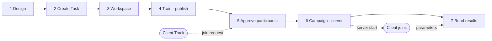

# Task Owner Track
{: .no_toc }

The track for the person who **designs, opens, and runs** federated learning. You decide what to learn, build and publish the code and first model that every participant will run identically, accept participants, run the training, and read the results. In this tutorial the Owner holds the data of the **Hungarian hospital**.

{: .note }
> Finish [Basics]({{ '/v1.3/tutorial/en/basics/' | relative_url }}) first.

| # | Page | Where | Where you meet the Client |
| --- | --- | --- | --- |
| 1 | [Design — First, Without FedOps]({{ '/v1.3/tutorial/en/owner/design/' | relative_url }}) | Terminal on my PC |  |
| 2 | [Create a Task]({{ '/v1.3/tutorial/en/owner/create-task/' | relative_url }}) | Console |  |
| 3 | [Put Code and Data into the Workspace]({{ '/v1.3/tutorial/en/owner/workspace/' | relative_url }}) | Studio |  |
| 4 | [Train the First Model and Publish to the Registry]({{ '/v1.3/tutorial/en/owner/release/' | relative_url }}) | Studio → Console | Once published, the Client can see the Task |
| 5 | [Approve Participants]({{ '/v1.3/tutorial/en/owner/participants/' | relative_url }}) | Console | **You receive the Client's join request** |
| 6 | [Configure the Campaign and Start the Server]({{ '/v1.3/tutorial/en/owner/campaign/' | relative_url }}) | Console | **When you start the server, the Client connects** |
| 7 | [Watch Training and Read the Results]({{ '/v1.3/tutorial/en/owner/results/' | relative_url }}) | Console | The Client's training results come together |

> **If you practice alone**, there is nobody to approve in chapter 5. In chapter 6 set Clients per round to `1`, and after starting the server in chapter 6, do [Client Track 3–4]({{ '/v1.3/tutorial/en/client/readiness/' | relative_url }}) with your own account, then come back to chapter 7.
