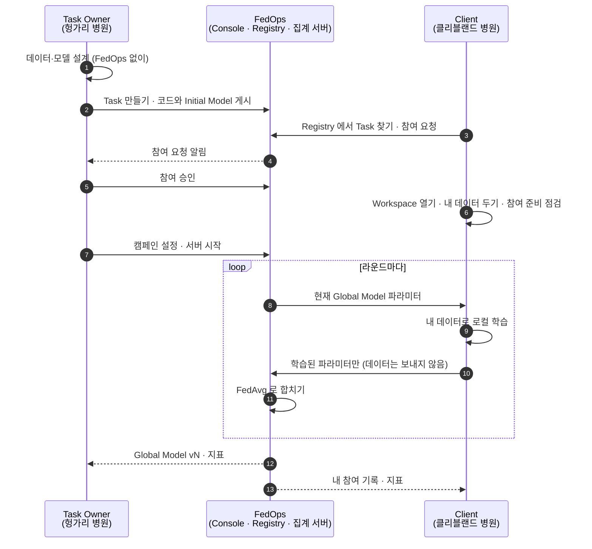

# FedOps 튜토리얼
{: .no_toc }

공개 의료 데이터 하나로 연합학습의 두 역할 — Task Owner 와 Client — 을 직접 해 보며 배우는 FedOps 1.3 튜토리얼
{: .fs-5 .fw-400 }

[English]({{ '/v1.3/tutorial/en/' | relative_url }})

{: .note }
> 이 튜토리얼은 버튼 순서만 알려 주지 않습니다. 각 단계에서 **지금 무엇을 하는지, 왜 하는지, 옵션을 바꾸면 무엇이 달라지는지**와 그 밑에 깔린 연합학습 배경을 함께 설명합니다. 다 따라 하고 나면 같은 흐름을 내 데이터와 내 모델에 적용할 수 있는 것이 목표입니다.

## 무엇을 하나요

**서로 다른 나라의 병원 두 곳**이 환자 기록을 한곳에 모으지 않고 **심장병 판별 모델(없음/있음)** 을 함께 학습합니다. 데이터는 실제로 병원별로 모아 공개된 UCI Heart Disease 입니다 — 헝가리 병원 기록은 **Task Owner** 가, 미국 클리블랜드 병원 기록은 **Client** 가 맡습니다. Owner 는 학습을 설계하고 운영하고, Client 는 자기 데이터로 학습에 참여합니다. 학습이 끝나면 그 모델을 LLM Agent 의 도구로 붙여 API 로 부르는 데까지 갑니다.

## 먼저 역할을 고르세요

| 나는… | 읽을 순서 |
| --- | --- |
| **연합학습을 열고 운영한다** (Task Owner) | [공통 기초]({{ '/v1.3/tutorial/basics/' | relative_url }}) → [Task Owner 트랙]({{ '/v1.3/tutorial/owner/' | relative_url }}) → (선택) [모델 활용 트랙]({{ '/v1.3/tutorial/model-use/' | relative_url }}) |
| **남이 연 연합학습에 내 데이터로 참여한다** (Client) | [공통 기초]({{ '/v1.3/tutorial/basics/' | relative_url }}) → [Client 트랙]({{ '/v1.3/tutorial/client/' | relative_url }}) |
| **혼자서 두 역할을 다 해 보고 싶다** | 공통 기초 → Owner 트랙 1~5 → Client 트랙 → Owner 트랙 6~7. 한 계정이 Owner 이자 Client 가 될 수 있습니다 |
| **만들어진 모델을 내 서비스에 붙이고 싶다** | [공통 기초]({{ '/v1.3/tutorial/basics/' | relative_url }}) → [모델 활용 트랙]({{ '/v1.3/tutorial/model-use/' | relative_url }}) |

## 전체 흐름 — 두 역할이 어디서 만나나

**두 역할이 만나는 곳은 세 군데뿐입니다.** ③ 참여 요청 ↔ ⑤ 승인, ⑦ 서버 시작 ↔ 라운드 참여, 그리고 결과입니다. 나머지는 각자 자기 화면에서 따로 진행합니다. 각 페이지 맨 위의 **📍 지금 어디** 상자가 이 그림의 어디쯤인지 알려 줍니다.

## 페이지를 읽는 법

모든 단계 페이지는 같은 틀로 되어 있습니다.

| 상자 | 내용 |
| --- | --- |
| 📍 **지금 어디** | 전체 흐름에서 현재 위치와 다음 단계 |
| 🎯 **이 단계에서 하는 일** | 무엇을, 왜 하는지 |
| 🖱️ **따라 하기** | 실제 화면 캡처. **빨간 네모 + 번호**가 누를 곳이고 설명의 번호와 같습니다 |
| ⚙️ **옵션 해설** | 화면의 각 옵션이 무엇을 정하는지, 바꾸면 무엇이 달라지는지, 이 튜토리얼은 왜 그 값을 골랐는지 |
| 📚 **연합학습 배경** | 그 선택 밑에 있는 연합학습 개념 (접힌 상자) |
| ✅ **체크리스트** | 다 채우면 다음 단계로 |

## 준비물과 시간

| 항목 | 필요한 것 |
| --- | --- |
| PC | macOS / Windows / Linux, 메모리 16 GB 권장, 디스크 20 GB 이상 여유 |
| Docker | 최신 Docker Desktop (또는 Docker Engine + compose) |
| Python | 3.10 이상 3.13 미만 (3.12 권장) |
| 계정 | FedOps 계정. 이 튜토리얼은 **Owner 1명 + Client 1명, 계정 2개**(PC 2대 권장) 기준입니다 |
| 데이터 | 실습 템플릿에 UCI Heart Disease 원본이 들어 있습니다. `prepare_data.py` 가 병원별 CSV 를 만들고, Owner 는 `hungarian`(헝가리), Client 는 `cleveland`(클리블랜드)를 씁니다 |

| 트랙 | 시간 |
| --- | --- |
| 공통 기초 (설치·LLM 다운로드 포함) | 1~2시간 |
| Task Owner | 2~3시간 |
| Client | 1시간 |
| 모델 활용 | 1~2시간 |

## 알아 둘 것

- **교육용 공개 데이터입니다.** 여기서 만든 모델은 진단에 쓰지 않습니다.
- **이 튜토리얼의 목표는 높은 정확도가 아니라 FedOps 로 연합학습을 끝까지 돌려 보는 것입니다.** 이 데이터의 정확도는 0.75~0.8 안팎이고, 화면의 숫자는 실측 **예시**입니다.
- **참여자마다 다른 병원 데이터를 씁니다.** 연합학습 중에는 서로의 데이터를 보내거나 보지 않습니다.
- FedOps 1.3 과 Agent Studio 의 2026-10 화면 기준입니다. 이후 버전에서 버튼 이름이 달라질 수 있습니다.
- 실습 템플릿: [https://github.com/gachon-CCLab/FedOps-hands-on-guide](https://github.com/gachon-CCLab/FedOps-hands-on-guide)
- 데이터 출처: Janosi, Steinbrunn, Pfisterer, Detrano (1989), *Heart Disease*, UCI Machine Learning Repository, [https://doi.org/10.24432/C52P4X](https://doi.org/10.24432/C52P4X) (CC BY 4.0)
