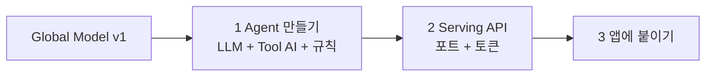

# 모델 활용 트랙
{: .no_toc }

연합학습으로 만든 Global Model 을 **실제로 쓰는** 트랙입니다. 모델을 LLM Agent 의 도구(Tool AI)로 붙이고, HTTP API 로 열고, 내 앱에서 부릅니다.

{: .note }
> 전제: [Owner 트랙 7장]({{ '/v1.3/tutorial/owner/results/' | relative_url }})까지 끝나 Global Model v1 이 있다. (연합학습을 건너뛰고 Owner 트랙 4장의 Initial Model 로도 진행할 수 있다) 이 트랙은 **Owner 계정** 기준입니다. Client 계정에서 같은 일을 할 수 있는지는 아직 확인하지 못했습니다.



```txt
Base LLM (언어)  +  Tool AI (내 모델)  +  Harness (규칙)  =  Agent
```

**숫자는 모델이, 문장은 LLM 이.** Agent 의 답에서 예측값(심장병 없음/있음 확률)은 연합학습으로 만든 Tool AI 가 내고, LLM 은 그 숫자를 사람 말로 설명만 합니다. 이 원칙이 이 트랙 전체를 관통합니다.

| # | 페이지 | 어디서 |
| --- | --- | --- |
| 1 | [AI Agent 만들기]({{ '/v1.3/tutorial/model-use/agent/' | relative_url }}) | Studio Agent Builder |
| 2 | [API 로 호출하기]({{ '/v1.3/tutorial/model-use/serving-api/' | relative_url }}) | Studio Agents + 터미널 |
| 3 | [데모 앱 · 내 프로젝트에 붙이기]({{ '/v1.3/tutorial/model-use/app/' | relative_url }}) | 브라우저 + 내 코드 |
