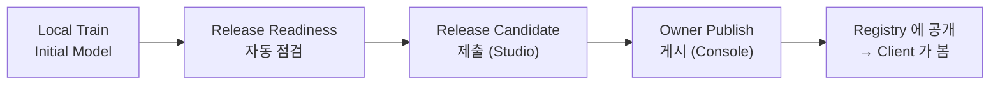

# 4. 첫 모델 학습과 Registry 게시
{: .no_toc }

{: .note }
> 📍 **지금 어디:** Task Owner 4/7 — ① 설계 → ② Task 만들기 → ③ Workspace → **④ 학습·게시** → ⑤ 승인 → ⑥ 캠페인 → ⑦ 결과  화면: **Agent Studio** → **FedOps Console** · 다음: Client 의 참여 요청을 기다린다

{: .important }
> 🎯 **이 단계에서 하는 일:** Owner 의 헝가리 데이터로 **첫 모델(Initial Model)** 을 만들고, 코드가 FedOps 와의 약속을 지키는지 자동 점검을 받은 뒤, 코드 + 첫 모델 + README 를 묶어 **Registry 에 게시**합니다. 게시하는 순간부터 **Client 가 이 Task 를 찾아 참여를 요청할 수 있습니다.** Owner 트랙에서 Client 와 처음 연결되는 지점입니다.

1. TOC
{:toc}

## 1) Local Train & Export Model

Agent Studio → Workspace → `handson-heart` → **Task Test** 탭에서 합니다. (3장 마지막에 `Data detected` 를 본 그 화면입니다)

1. **Local Train & Export Model** 을 누른다.

아래로 내리면 왼쪽 기록에 `running · Local Train` 이 생기고, 오른쪽 검은 창에 진행 로그가 나옵니다. **약 2분** 기다립니다(2026-10-20 Mac 실측).

STATUS 가 `succeeded` 로 바뀌고 지표 카드가 나오면 끝입니다. 네모 친 카드를 봅니다(2026-10-20 실측, 헝가리 261행 가운데 test 53행).

| 카드 | 값 |
| --- | --- |
| PRIMARY METRIC (accuracy) | **0.7736** |
| F1 MACRO | 75.39% |
| F1 NO DISEASE / F1 DISEASE | 82.35% / **68.42%** |

- **0.62(전부 "심장병 없음"으로 찍기)보다 확실히 크면 통과**입니다. 헝가리 데이터는 심장병 없음이 62% 입니다.
- 1장 일반 학습(두 병원을 모은 약 0.8)보다 낮을 수 있습니다. 여기서는 헝가리 데이터만 썼습니다.
- **F1 DISEASE 를 보세요.** 심장병 환자를 얼마나 잘 잡는지입니다. 헝가리 데이터는 심장병 환자가 98명뿐이라 이 값(68.42%)이 accuracy 보다 낮게 나왔습니다. test 의 심장병 환자 20명 가운데 7명을 "없음"으로 놓쳤습니다(CONFUSION 1 0 = 7). 연합학습(6장)에서 이 값이 어떻게 바뀌는지 봅니다.

> **이 모델이 왜 중요한가:** 여기서 만든 모델이 **Initial Model** 입니다. 6장에서 연합학습을 시작하면 서버는 이 모델을 라운드 1 의 출발점으로 모든 Client 에게 보냅니다. 아무렇게나 시작하는 것보다 어느 정도 배운 모델에서 시작하면 라운드가 적게 듭니다.

## 2) Check Release Readiness

FedOps 가 Task 가 약속을 지켰는지 하나씩 검사합니다.

1. 위로 올라가 **Check Release Readiness** 를 누른다. (2~3분, 2026-10-20 실측 2분 24초)

### ⚙️ 해설 — Readiness 는 무엇을 막나

| 점검 | 통과 못 하면 생길 일 |
| --- | --- |
| 필수 파일과 README 섹션 | Client 가 데이터 형식·용도·제약을 알 수 없다 |
| 모델 파일 크기·체크섬 | 배포 중 깨진 모델을 Client 가 받는다 |
| 짧게 학습해 손실이 유한하고 파라미터가 바뀌는지 | Client 들이 아무것도 배우지 못하는 학습을 몇 라운드씩 돌린다 |
| 내 모델로 연합학습 클라이언트를 만들 수 있는지 | 서버 시작 뒤에야 연결 오류가 난다 |
| Tool AI 예측이 도는지 | 모델 활용 트랙에서 Agent 가 모델을 못 부른다 |
| 원본 데이터·경로가 새지 않는지 | 게시물에 Owner 의 데이터나 PC 경로가 섞여 공개된다 |

연합학습은 문제가 생기면 여러 기관의 PC 에서 동시에 터집니다. 그래서 **게시 전에 Owner 의 PC 에서 한 번 미리 다 돌려 보는** 단계가 있습니다.

## 3) Submit Release Candidate

버튼 아래에 **"✓ Release Readiness passed. This Workspace can be submitted."** 가 나오면 통과입니다.

{: .note }
> 아래 ACCURACY **25.00%** 같은 낮은 숫자는 신경 쓰지 않아도 됩니다. 검사용으로 아주 짧게 학습시킨 값입니다. 모델 성능은 1) 의 0.7736 입니다.

1. **Submit Release Candidate** 를 누른다.

몇 초 뒤 **"Release Candidate submitted: revision 1 · ready · release-…"** 가 나오면 됩니다. 여기까지가 Studio 에서 할 일입니다.

## 4) Registry 에 게시 (FedOps Console)

이제 브라우저에서 **FedOps Console**(`https://ccl.gachon.ac.kr/fedops/console`)로 갑니다.

1. My Federated Tasks 에서 **handson-heart** 카드를 누른다.

1. **Registry Release** 탭을 누른다.

1. **Refresh Releases** 를 누른다. Revision 1 이 안 보일 때만 필요합니다.
2. Revision 1 의 **Make Public & Owner Publish** 를 누른다. 확인 창 없이 바로 게시됩니다.

{: .warning }
> **게시하면 Task 가 Public 이 됩니다.** Private 으로 만들었어도 그렇습니다. 공개되는 것은 코드·모델·README 이고 데이터는 올라가지 않습니다. 실습이 끝난 뒤 공개를 원치 않으면 Console 의 Task actions → **Delete task** 로 지울 수 있습니다.

배지가 `Private` → **`Public`**, Revision 1 이 **`published`** 로 바뀌고, 오른쪽 버튼이 `Withdraw`(게시 취소)로 바뀝니다.

1. **View in Registry** 를 누르면 공개된 모습을 새 탭에서 볼 수 있다.

## 5) Registry 에서 확인

위쪽 메뉴의 **Registry** 목록에 **Heart Disease MLP** 카드가 보입니다. 카드 제목은 Task 이름이 아니라 `config.yaml` 의 모델 표시명(`display_name`)입니다. 다른 사람이 이 카드로 Task 를 찾아 참여를 요청할 수 있습니다.

카드를 누르면 **Federated Task Card** 에 템플릿의 `README.md` 가 그대로 보입니다. 열 10개의 뜻, 데이터 출처, 쓰면 안 되는 용도(진단)가 적혀 있습니다. README 가 곧 공개 문서입니다.

### ⚙️ 옵션 해설 — 게시 관련 버튼

| 버튼 | 하는 일 | 이 튜토리얼 |
| --- | --- | --- |
| **Make Public & Owner Publish** | Release Candidate 를 Published Release 로 확정하고 Task 를 Public 으로 바꾼다 | 누름 — Client 가 찾으려면 공개되어야 함 |
| **Withdraw** | 게시를 취소한다 | 누르지 않음 (실습에서 확인하지 않음) |
| Task actions → **Delete task** | Task 를 지운다. 되돌릴 수 없다 | 실습을 끝내고 공개를 원치 않을 때 |

**Release 는 고정된 묶음입니다.** 게시 뒤에 Workspace 의 코드를 고쳐도 Client 에게 가는 코드는 바뀌지 않습니다. 코드를 바꾸려면 다시 Readiness → Release Candidate(revision 2) → 게시를 해야 합니다.

📚 연합학습 배경 — 왜 Release 를 고정하나

한 라운드 안에서 모든 Client 는 **똑같은 코드와 똑같은 모델 구조**로 학습해야 합니다. 어떤 Client 는 옛 코드, 어떤 Client 는 새 코드로 학습하면 파라미터 모양이 달라 합칠 수 없거나, 합쳐지더라도 의미가 섞입니다. 그래서 FedOps 는 게시된 Release 를 바꿀 수 없는 스냅샷으로 다루고, 서버를 시작할 때 "어느 Release 로, 어느 모델에서 시작하는지"를 함께 고정합니다(6장).

## ✅ 체크리스트

- [ ] Local Train 이 `succeeded` 이고 PRIMARY METRIC 이 0.62 보다 크다
- [ ] `Release Readiness passed` 가 나왔다
- [ ] `Release Candidate submitted: revision 1` 이 나왔다
- [ ] Console 에서 Task 가 `Public`, Revision 1 이 `published` 다
- [ ] Registry 에서 Heart Disease MLP 카드와 README 가 보인다

## 안 되면

| 증상 | 조치 |
| --- | --- |
| PRIMARY METRIC 이 0.62 근처 | `config.yaml` 의 `epochs` 를 올린다(기본 30) |
| Local Train 이 바로 실패하고 데이터 관련 오류 | 3장 4) 로 돌아가 `Data detected` 인지 확인한다 |
| 어휘표에 없는 값 오류 (`cp`·`restecg`) | `dataset.csv` 를 손으로 고쳤거나 다른 데이터를 넣었다. `prepare_data.py` 로 다시 만든다 |
| `README is missing sections` | README 에 Intended use / Local data setup / Federated participation / Limitations / Privacy 섹션이 있어야 한다 |
| `model.display_name must be finalized` | `config.yaml` 의 `display_name` 이 기본값 그대로다. 템플릿의 `config.yaml` 을 넣었는지 확인 |
| 클래스 부족 오류 | 클래스마다 3행 이상 필요하다 |
| Submit Release Candidate 가 눌리지 않음 | Release Readiness 를 먼저 통과해야 한다. 코드를 고쳤으면 다시 검사한다 |
| Registry Release 에 후보가 안 보임 | **Refresh Releases** 를 누른다 |
| 실수로 게시했다 | Registry Release 탭에 게시 취소 버튼 **Withdraw** 가 있다(실습에선 눌러 보지 않았다). Task 를 완전히 내리려면 Task actions → **Delete task** |

## 다음 단계

[5. 참여자 승인]({{ '/v1.3/tutorial/owner/participants/' | relative_url }}) — 이제 Client 가 이 Task 를 찾아 참여를 요청할 수 있습니다. Client 쪽에서 일어나는 일은 [Client 트랙 1장]({{ '/v1.3/tutorial/client/join/' | relative_url }})에 있습니다.
