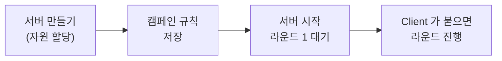

# 6. 캠페인 설정과 서버 시작
{: .no_toc }

{: .note }
> 📍 **지금 어디:** Task Owner 6/7 — ① 설계 → ② Task 만들기 → ③ Workspace → ④ 학습·게시 → ⑤ 승인 → **⑥ 캠페인** → ⑦ 결과<br> 화면: **FedOps Console** · 상대편: 서버를 켜면 Client 가 [Client 트랙 4장]({{ '/v1.3/tutorial/client/federated-learning/' | relative_url }})에서 참여를 시작한다 · 다음: 학습을 지켜보고 결과를 읽는다

{: .important }
> 🎯 **이 단계에서 하는 일:** 이번 연합학습 한 판(**캠페인**)의 규칙 — 몇 라운드를, 한 라운드에 몇 명이 참여하면, 어떤 방식으로 합칠지 — 을 정하고, 파라미터를 모아 합칠 **집계 서버**를 켭니다. 이 튜토리얼에서 옵션이 가장 많고, 결과에 가장 직접 영향을 주는 단계입니다.

1. TOC
{:toc}



## 1) 집계 서버 만들기

FedOps Console → My Federated Tasks → `handson-heart` 로 들어갑니다.


1. **Server Management** 탭을 누른다.


1. 아래로 내려 Server lifecycle 의 **Create scalable server** 를 누른다. 확인 창 없이 바로 만들기 시작합니다.


맨 위 Runtime overview 의 **FL server** 칸이 `FL Server Creating` → **`FL Server created`** 가 될 때까지 기다립니다. 2026-10-20 실측 1분 30초.

1. 바뀌지 않으면 **Refresh status** 를 누른다.

> **"만들기"와 "시작"은 다릅니다.** 여기서는 클라우드에 서버가 돌 자리(컴퓨팅 자원)를 마련할 뿐이고, 연합학습은 아직 시작되지 않습니다.

## 2) 캠페인 규칙 정하기


1. **Rounds** 를 정한다.
2. **Clients per round** 를 정한다. 기본값이 `1` 이니 `2` 로 바꾼다. (아래 표 참고)
3. **Check evaluation setup** 을 누른다. 서버가 `FL Server created` 가 된 뒤에 누르세요. 그 전에 누르면 `Validation check unavailable` 이 나옵니다.
4. **Save campaign** 을 누른다.

| 상황 | Rounds | Clients per round |
| --- | --- | --- |
| **혼자 연습** (Owner 가 Client 도 함) | 2 | **1** |
| **이 튜토리얼** (Owner + Client 1명) | **2** | **2** — 두 병원 모두 참여해야 라운드가 진행됨 |
| 병원을 더 받을 때 (예: VA 병원까지 3명) | 2 이상 | 실제 참여 인원 |


초록 **Evaluation setup ready** 와 **Saved** 가 보이면 됩니다.

### ⚙️ 옵션 해설 — 캠페인

| 옵션 | 무엇을 정하나 | 늘리거나 바꾸면 | 이 튜토리얼 |
| --- | --- | --- | --- |
| **Rounds** | 서버가 "배포 → 로컬 학습 → 합치기"를 몇 바퀴 돌지 (1 이상) | 늘리면 Global Model 이 더 다듬어질 수 있지만 시간과 통신이 늘고, 어느 순간부터는 거의 좋아지지 않는다 | **2** — 흐름을 보는 것이 목적이라 짧게. FedOps 템플릿의 권장값도 2 |
| **Clients per round** | 한 라운드에서 **몇 명이 학습을 마쳐야** 서버가 합치는지 (1 이상) | 늘리면 한 라운드에 더 많은 데이터가 반영되지만, 그 인원이 모일 때까지 서버가 기다린다. **실제 참여 인원보다 크면 라운드가 시작되지 않는다** | **2** — 실제로 참여할 인원 수(Owner + Client) |
| **Aggregation strategy** | 파라미터를 합치는 방법 | FedOps 1.3 에서는 **FedAvg 하나만** 고를 수 있다. 목록은 게시한 Release 가 지원한다고 선언한 방식에서 온다 | **FedAvg** |
| **Global model evaluation** | Global Model 의 점수를 어디서 매기는지 | 아래 따로 설명 | **Validation OFF · Client metrics** |

#### Global model evaluation

| 선택지 | 점수를 매기는 곳 | 필요한 것 | 장단점 |
| --- | --- | --- | --- |
| **Validation OFF · Client metrics** | 각 Client 가 자기 test 데이터로 평가하고, 서버는 그 점수를 **데이터 수에 비례해 가중 평균** | 없음 | Owner 가 검증 데이터를 따로 준비하지 않아도 된다. 대신 병원마다 데이터가 다르면 점수의 기준도 달라진다 |
| **Validation ON · Server evaluation** | 서버가 Owner 가 올린 **공통 검증 데이터**로 Global Model 을 직접 평가 | Studio 에서 올린 서버 검증 데이터셋, Check evaluation setup 통과 | 모든 라운드를 같은 잣대로 비교할 수 있다. 대신 Owner 가 대표성 있는 검증 데이터를 갖고 있어야 하고, 그 데이터가 서버로 올라간다 |

이 튜토리얼은 **OFF** 를 씁니다. Owner 가 서버에 데이터를 올리지 않고도 연합학습이 돌아가는 기본 형태이기 때문입니다. 템플릿의 `config.yaml` 도 `server_evaluation.enabled: false` 입니다. ON 은 이 튜토리얼에서 다루지 않습니다.

<details markdown="1">
<summary>📚 연합학습 배경 — FedAvg 와 라운드</summary>

**FedAvg (Federated Averaging)** 는 2017년 Google 이 제안한, 가장 기본적인 집계 방식입니다. 각 client 가 보낸 파라미터를 **데이터 수에 비례한 가중치**로 평균합니다.

```txt
Global = (n₁ × 헝가리의 파라미터 + n₂ × 클리블랜드의 파라미터) / (n₁ + n₂)
         n = 각자 이번 라운드에 학습한 행 수 (Client 가 파라미터와 함께 서버에 보냄)
```

데이터가 많은 병원의 의견이 더 크게 반영됩니다. 이 튜토리얼에서는 클리블랜드(303행)가 헝가리(261행)보다 조금 더 크게 반영됩니다. non-IID 에서는 데이터가 많은 병원의 분포 쪽으로 Global Model 이 기웁니다.

**라운드와 로컬 학습의 균형.** 각 라운드 안에서 client 는 로컬 데이터로 여러 번 학습합니다. 로컬 학습을 많이 할수록 통신(라운드)은 덜 필요하지만, non-IID 에서는 각자 자기 데이터 쪽으로 멀리 가 버려(client drift) 합쳤을 때 오히려 나빠질 수 있습니다. FedProx 같은 방식이 이 문제를 줄이려고 나왔습니다(FedOps 1.3 에는 없음).

**Clients per round 는 "기다림"의 규칙이기도 합니다.** 서버는 정해진 인원이 학습을 마칠 때까지 기다립니다. 한 Client 가 Stop Client 로 빠져도 이 값은 자동으로 줄지 않고, 서버는 다른 참여 가능한 Client 를 계속 기다립니다.

</details>

## 3) 서버 시작


1. Command console 의 **Start FL server** 를 누른다.
2. **Show live log** 를 누른다.

![live log 의 [ROUND 1]]({{ '/tutorial/images/ho6-08.png' | relative_url }})

Live server log 맨 아래에 **`[ROUND 1]`**, **`server start by round`** 가 보이면 서버가 참여자를 기다리는 중입니다.

{: .highlight }
> live log 를 위로 올려 보면 AWS 관련 DEBUG 줄이 많이 나옵니다. 그 안에 서버의 접근 키 ID 가 찍히는 줄이 있으니 **live log 화면을 캡처해 공유하지 마세요.** (FedOps 팀에 전달할 결함입니다)

### ⚙️ 해설 — Start FL server 를 누르면 고정되는 것

Start FL server 는 다음을 한 묶음으로 고정합니다.

| 고정되는 것 | 뜻 |
| --- | --- |
| 저장된 캠페인 규칙 | 이번 판의 Rounds·Clients per round·집계 방식 |
| 새 캠페인 실행 ID | 이번 판의 기록이 다른 판과 섞이지 않게 |
| 게시된 Release | 모든 Client 가 같은 코드로 학습하게 (4장) |
| 시작 모델 | 첫 캠페인은 **Initial Model**, 다음 캠페인은 직전 **Global Model vN** |

그래서 서버가 도는 중에 캠페인 값을 바꿔도 이번 판에는 적용되지 않습니다. 같은 Task 의 서버가 이미 돌고 있으면 중복 시작도 막힙니다.

| 버튼 | 하는 일 |
| --- | --- |
| **Stop server** | 진행 중인 연합학습 프로세스를 멈춘다 |
| **Pause** (Server lifecycle) | 컴퓨팅 자원을 반납하되 필요한 데이터는 보존한다. 실습이 끝나면 누른다 |
| **Resume** | Pause 한 서버를 되살린다 |

## 4) Client 에게 알리기

서버가 `[ROUND 1]` 에서 기다리는 지금이 Client 가 참여할 때입니다. Client 에게 "서버를 켰다"고 알리세요. **Owner 도 참여자(헝가리 병원)이므로**, Owner 자신도 Studio 에서 [Client 트랙 3장]({{ '/v1.3/tutorial/client/readiness/' | relative_url }})과 4장대로 Start Client 를 눌러야 두 명이 채워집니다. Client 는 [Client 트랙 4장]({{ '/v1.3/tutorial/client/federated-learning/' | relative_url }})을 진행합니다.

{: .highlight }
> **서버를 켜면 참여 준비 점검이 다시 필요합니다.** 새 캠페인 서버가 켜지면 Owner·Client 모두 Studio 의 Task Data 가 `Check required` 로 돌아갑니다. Start Client 전에 **Check Participation Readiness** 를 다시 눌러 `✓ Local Ready` 를 확인합니다. 2026-10-20 Mac(Owner) 에서는 1분 16초 걸렸습니다.

> **혼자 연습한다면** 지금 Studio 로 가서 [Client 트랙 3장]({{ '/v1.3/tutorial/client/readiness/' | relative_url }})과 4장을 내 계정으로 진행합니다. Owner 의 Workspace 에는 이미 헝가리 데이터가 있습니다.

## ✅ 체크리스트

- [ ] Server Management 에서 `FL Server created` 를 봤다
- [ ] Clients per round 를 실제 참여 인원에 맞췄다
- [ ] `Evaluation setup ready` · `Saved` 를 봤다
- [ ] live log 에 `[ROUND 1]` 이 보였다
- [ ] Client 에게 서버를 켰다고 알렸다

## 안 되면

| 증상 | 조치 |
| --- | --- |
| Start FL server 가 비활성 | 서버가 아직 Creating 이다. Refresh status 로 `created` 를 기다린다 |
| `Validation check unavailable` | 서버가 `created` 가 되기 전에 Check evaluation setup 을 눌렀다. 기다렸다 다시 누른다 |
| 서버가 라운드를 시작하지 않음 | Clients per round 만큼 Client 가 붙어야 시작한다. 승인한 인원과 실제 참여 인원을 확인한다. Owner 도 Start Client 를 눌렀는지 확인한다 |
| 서버를 켰는데 Studio 에 계속 `Server Offline` | Studio 표시가 몇 분 늦게 바뀔 수 있다. 연합학습 화면의 **Refresh** 를 누른다 |
| Start Client 를 누르자 `[Errno 2] No such file or directory: '…/task-binding.tmp'` | 준비 점검 직후 Studio 가 파일을 쓰는 중에 눌린 것으로 보인다(2026-10-19 Mac 에서 한 번). **Refresh** 를 누르고 Start Client 를 다시 누르면 된다 |
| Console Monitoring 의 접속 수(`online now`)가 안 바뀐다 | Monitoring 은 몇 분 간격으로 갱신된다. Studio 의 상태(`waiting_round`, `training`)를 기준으로 본다 |

## 다음 단계

[7. 학습 지켜보기와 결과 읽기]({{ '/v1.3/tutorial/owner/results/' | relative_url }})
