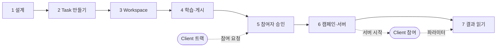

# Task Owner 트랙
{: .no_toc }

연합학습을 **설계하고 열고 운영하는** 사람의 트랙입니다. 무엇을 학습할지 정하고, 모든 참여자가 똑같이 실행할 코드와 첫 모델을 만들어 공개하고, 참여자를 받아 학습을 돌리고 결과를 읽습니다. 이 튜토리얼에서 Owner 는 **헝가리 병원**의 데이터를 가지고 있습니다.

{: .note }
> 먼저 [공통 기초]({{ '/v1.3/tutorial/basics/' | relative_url }})를 끝내세요.

| # | 페이지 | 어디서 | Client 와 만나는 곳 |
| --- | --- | --- | --- |
| 1 | [설계하기 — FedOps 없이 먼저]({{ '/v1.3/tutorial/owner/design/' | relative_url }}) | 내 PC 터미널 |  |
| 2 | [Task 만들기]({{ '/v1.3/tutorial/owner/create-task/' | relative_url }}) | Console |  |
| 3 | [Workspace 에 코드와 데이터 넣기]({{ '/v1.3/tutorial/owner/workspace/' | relative_url }}) | Studio |  |
| 4 | [첫 모델 학습과 Registry 게시]({{ '/v1.3/tutorial/owner/release/' | relative_url }}) | Studio → Console | 게시하면 Client 가 Task 를 볼 수 있다 |
| 5 | [참여자 승인]({{ '/v1.3/tutorial/owner/participants/' | relative_url }}) | Console | **Client 의 참여 요청을 받는다** |
| 6 | [캠페인 설정과 서버 시작]({{ '/v1.3/tutorial/owner/campaign/' | relative_url }}) | Console | **서버를 켜면 Client 가 붙는다** |
| 7 | [학습 지켜보기와 결과 읽기]({{ '/v1.3/tutorial/owner/results/' | relative_url }}) | Console | Client 의 학습 결과가 모인다 |

> **혼자 연습한다면** 5장에서 승인할 사람이 없습니다. 6장에서 Clients per round 를 `1` 로 두고, 6장의 서버 시작 뒤 [Client 트랙 3~4장]({{ '/v1.3/tutorial/client/readiness/' | relative_url }})을 내 계정으로 진행한 다음 7장으로 돌아오세요.
